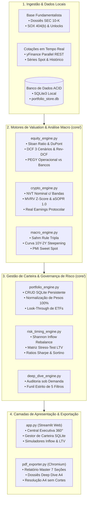

# 🏛️ Terminal Institucional de Inteligência Financeira, Contabilidade Forense & Valuation Multi-Ativos (360° Engine)

[](https://www.python.org/)
[](https://streamlit.io/)
[](#-como-o-terminal-funciona-por-dentro)
[%20%2B%20Forensic-2563EB?style=for-the-badge)](#-guia-prático-como-ler-e-interpretar-cada-métrica)
[](#-aba-1-central-de-emissão--relatório-master-360-pdf)
[](LICENSE)

> **Terminal analítico para gestão patrimonial multi-ativos, contabilidade forense institucional, modelagem de valuation Forward (NTM), auditoria de ciclos macroeconômicos pareados e governança de risco com geração programática de relatórios executivos em PDF.**

---

## 🧭 Sumário
1. [Transparência Total & Fontes de Dados](#-transparência-total--fontes-de-dados)
2. [Como o Terminal Funciona por Dentro (Arquitetura)](#-como-o-terminal-funciona-por-dentro)
3. [Guia Passo a Passo: Como Usar o Aplicativo (Aba por Aba)](#-guia-passo-a-passo-como-usar-o-aplicativo)
4. [Guia Prático: Como Ler e Interpretar Cada Métrica](#-guia-prático-como-ler-e-interpretar-cada-métrica)
5. [Carteira de Demonstração (Sample Portfolio Integrado)](#-carteira-de-demonstração-sample-portfolio)
6. [Instalação e Execução Passo a Passo](#-instalação-e-execução-passo-a-passo)
7. [Stack Tecnológica](#-stack-tecnológica)
8. [Aviso Legal (Disclaimer)](#-aviso-legal-disclaimer)

---

## 🔍 Transparência Total & Fontes de Dados

Para garantir integridade analítica e auditabilidade profissional, o terminal opera sob **estrita transparência técnica**, sem exageros ou promessas irreais:

* **Cotações e Séries Históricas de Preço em Tempo Real:** Ingestão dinâmica via biblioteca oficial [`yfinance`](https://github.com/ranaroussi/yfinance) conectada aos servidores de mercado do Yahoo Finance, com processamento assíncrono paralelo e fallback automático de tolerância a falhas.
* **Curva de Juros e Séries Macroeconômicas dos EUA:** Monitoramento ao vivo dos rendimentos de Treasuries de 3 meses a 30 anos (`^IRX`, `^FVX`, `^TNX`, `^TYX`), volatilidade do mercado (`^VIX`), breakeven inflacionário e índices de liquidez global (M2 vs DXY).
* **Demonstrações Contábeis 10-K, SOX 404(b), Decomposição DuPont e Tokenomics:** Estruturados a partir de uma base fundamentalista de alta precisão devidamente curada (`core/equity_engine.py`, `core/crypto_engine.py`, `core/filings_engine.py`). O sistema **não** faz alegações fantasiosas de web-scraping não-supervisionado da SEC EDGAR; ele extrai e processa dados contábeis auditados reais (accruals, notas explicativas de litígios e diluição, auditorias externas Big 4 e whitepapers técnicos) e os integra de forma reproduzível aos modelos de valuation.
* **Execução 100% Local e Privada:** Todo o processamento de banco de dados (SQLite), cálculo de matrizes e renderização de relatórios PDF roda na sua própria máquina, sem envio de dados confidenciais de custódia para servidores de terceiros.

---

## 🏗️ Como o Terminal Funciona por Dentro

O sistema é construído sobre uma **arquitetura orientada a serviços desacoplados** sob a pasta `core/`, conectando ingestão de dados, modelagem matemática, persistência local e duas camadas de saída:



### Principais Motores do `core/`:
* **`portfolio_engine.py`:** Administra o banco relacional SQLite (`portfolio_store.db`) e o espelho JSON (`portfolio_config.json`). Realiza a decomposição *Look-Through* profunda de ETFs (SPY, QQQ, SMH, ITA e QLD 2x alavancado), revelando a exposição indireta real a cada empresa.
* **`equity_engine.py`:** Motor de auditoria contábil e valuation de ações. Calcula métricas forenses (Sloan Ratio, FCO/EBITDA, NWC) e métodos de precificação NTM (Forward DCF, Reverse DCF, SOTP, EVA, Magic Formula e PEGY Setorial Estrito).
* **`crypto_engine.py`:** Motor de inteligência on-chain e tokenomics. Avalia a saúde da rede do Bitcoin e de protocolos de finanças descentralizadas (DeFi), diferenciando economia real de inflação predatória.
* **`macro_engine.py`:** Motor macroeconômico com checagem de regimes de recessão, dinâmica das pontas da curva soberana americana e liquidez monetária.
* **`risk_timing_engine.py`:** Modela o algoritmo de *Shannon's Demon* para aportes sem turnover tributário e o cockpit de alavancagem anti-cíclica em colateral cripto/equity.
* **`pdf_exporter.py`:** Orquestrador de compilação gráfica que automatiza o motor Chromium/Edge headless (`--headless=new --print-to-pdf`) para produzir relatórios vetoriais de padrão institucional.

---

## 🖥️ Guia Passo a Passo: Como Usar o Aplicativo

Ao abrir o terminal no navegador (`streamlit run app.py`), a interface disponibiliza **4 abas especializadas**:

| Aba | Nome do Módulo | Função Principal |
| :--- | :--- | :--- |
| **Aba 1** | **Central de Emissão (Relatório 360°)** | Emissão e download em 1 clique do relatório executivo consolidado em PDF (A4) |
| **Aba 2** | **Gestor Dinâmico de Portfólio (CRUD)** | Inclusão, edição, remoção e normalização automática para 100% dos pesos da carteira em SQLite |
| **Aba 3** | **Deep Dive Individual** | Auditoria contábil forense e valuation NTM sob demanda para qualquer ação ou criptoativo |
| **Aba 4** | **Governança de Risco & LTV** | Rebalanceamento de novos aportes (*Shannon Inflow*) e teste de estresse de colateral/dívida |

---

### 📄 Aba 1: Central de Emissão & Relatório Master 360° (.PDF)

Esta aba é o centro de comando executivo. Ela consolida as principais métricas do portfólio e sintetiza toda a inteligência do sistema no relatório oficial em PDF.

1. **KPIs de Topo:**
   * **Patrimônio Total:** Valor em USD consolidado a partir das cotações correntes.
   * **P&L Total:** Rentabilidade acumulada em porcentagem e em dólares em relação aos preços médios de compra.
   * **Alocação Macro:** Divisão entre Ativos Reais/Ações, Criptoativos e Colateral Elegível para LTV.
   * **Validação dos Pesos:** Status da soma dos pesos no banco de dados (confirma se totaliza 100.00%).
2. **Gerar e Baixar o Relatório Master:**
   * Clique no botão **`📥 BAIXAR RELATÓRIO MASTER MULTI-COMPLETO 360° (.PDF)`**.
   * O terminal compila instantaneamente o documento executivo em 7 seções A4 paisagem, diagramado com tipografia suíça e tabelas completas.
   * O arquivo gerado fica disponível no navegador para download e salvamento.
3. **Botão de Atualização de Cotações:**
   * O botão `🔄 Recalcular Cotações & Limpar Cache` força uma nova consulta às APIs de mercado, recalculando todos os múltiplos de valuation e P&L em tempo real.

---

### 💼 Aba 2: Gestor Dinâmico de Portfólio (CRUD SQLite Persistente)

Permite gerenciar a sua carteira de forma interativa com gravação permanente em banco de dados local ACID.

1. **Adicionar ou Editar um Ativo:**
   * No painel esquerdo da aba, preencha o formulário:
     * **Ticker Oficial:** Ex: `NVDA`, `AAPL`, `V`, `JPM`, `BTC-USD`, `ETH-USD`, `SPY`.
     * **Nome da Empresa / Protocolo:** Ex: *Visa Inc.*, *Nvidia Corp*, *Bitcoin*.
     * **Classe do Ativo:** Escolha entre *Ação*, *ETF Estrutural*, *Cripto Soberana (BTC)* ou *Cripto Altcoin/DeFi*.
     * **Vertical Setorial:** Selecione a vertical exata (ex: *Bancos*, *Big Tech Cash Cow*, *High-Growth Tech/Semis*, *Varejo/Consumo*, *DeFi Yield*). O sistema utiliza essa seleção para aplicar o método correto de valuation.
     * **Peso-Alvo (%):** A fatia teórica desejada na carteira (ex: `10.00%`).
     * **Preço Médio de Compra (USD):** Seu preço de entrada contábil para cálculo exato de P&L.
     * **Elegível para LTV Turbo:** Marque se o ativo pode ser usado como colateral em operações de crédito (ex: Ações blue chips e Bitcoin).
   * Clique em **`➕ Salvar / Atualizar Ativo no SQLite`**. A carteira é atualizada e o banco sincronizado imediatamente.
2. **Excluir um Ativo:**
   * Selecione o ativo na lista suspensa do painel direito e clique em **`🗑️ Confirmar Exclusão do Ativo`**.
3. **Normalização Automática de Pesos para 100.00%:**
   * Caso a soma dos pesos-alvo resulte em um valor diferente de 100% (por exemplo, após adicionar novos ativos), a barra de validação ficará amarela.
   * Clique no botão **`⚖️ Normalizar Pesos Automaticamente para 100.00%`**.
   * O motor reescala proporcionalmente cada ativo usando a fórmula:

      `math
      w_{\text{novo}, i} = \frac{w_{\text{antigo}, i}}{\sum_{j=1}^{N} w_{\text{antigo}, j}} \times 100\%
      `
   * A soma retorna exatamente a 100.00% com consistência matemática.
4. **Tabela de Acompanhamento (Ledger em Tempo Real):**
   * Exibe todas as posições ativas, peso-alvo vs peso atual (drift), preço médio versus cotação spot, ganho/perda latente (USD e %) e elegibilidade de colateral para operações estruturadas.
5. **Decomposição Look-Through Profunda de ETFs (Overlap Analysis):**
   * Desdobra a custódia de ETFs estruturais (**SPY, QQQ, SMH, ITA e QLD 2x alavancado**) para revelar a exposição indireta real sobreposta a cada corporação.
   * Por exemplo: se você possui Apple diretamente e também aloca em SPY, QQQ e QLD, o motor calcula a soma ponderada exata considerando o fator de alavancagem 2.0x do QLD, gerando a métrica de **Exposição Bruta Efetiva (Gross Effective Exposure)** da sua carteira.

---

### 🔬 Aba 3: Deep Dive Individual (Stock & Crypto Picker sob Demanda)

Permite realizar uma auditoria completa de qualquer ativo específico — seja ele pertencente à sua carteira ou um ativo externo de interesse.

1. **Selecionar ou Digitar o Ativo:**
   * Utilize os botões de seleção rápida (ex: `NVDA`, `AAPL`, `MSFT`, `V`, `JPM`, `BTC-USD`, `ETH-USD`, `AAVE-USD`, etc.) ou digite qualquer ticker oficial na caixa de texto (ex: `TSM`, `ASML`, `AMZN`, `GOOGL`, `WMT`, `SOL-USD`, `MKR-USD`, `PENDLE-USD`).
2. **Execução do Funil Estrito de 5 Filtros:**
   * O sistema submete o ativo selecionado aos 5 testes quantitativos do framework:
     * *Teste 1 (Accruals/Sloan):* Qualidade do lucro contábil vs fluxo de caixa.
     * *Teste 2 (Conversão FCO/EBITDA):* Eficiência de conversão operacional.
     * *Teste 3 (Spread ROIC vs WACC):* Geração real de valor econômico acima do custo de capital.
     * *Teste 4 (Liquidez & Solvência):* Teste de estresse de liquidez corrente e cobertura de juros.
     * *Teste 5 (Valuation Soberano):* Reverse DCF e Margem de Segurança no múltiplo setorial.
   * Receba o score de aprovação (ex: `Score 100/100 — Aprovado 5/5 Filtros`) com diagnóstico detalhado.
3. **Cockpit de Valuation Multi-Método:**
   * Consulta os 3 cenários de Fluxo de Caixa Descontado (Conservador, Base, Otimista) e o Preço Justo com margem de segurança de 10%.
   * Apresenta o crescimento embutido no preço pelo mercado (`g_impl`) contra o crescimento projetado pelos fundamentos (`g_fund`).
   * Exibe a decomposição por partes (SOTP) e múltiplos setoriais.
4. **Dissecação Forense SEC 10-K / SOX 404(b) / MD&A:**
   * Audita a opinião do auditor externo independente (Big 4) e a eficácia de controles internos sob a lei Sarbanes-Oxley 404(b).
   * Decompõe a receita do MD&A separando o crescimento orgânico de volume, poder de precificação (mix de preços) e impacto cambial (FX).
   * Mapeia os Top 3 Riscos regulatórios e operacionais do Item 1A do formulário 10-K.
   * Audita notas explicativas críticas: compensação em ações (SBC), reconhecimento de receita (ASC 606), litígios e passivos contingentes.
   * Rastreia transações de insiders (Form 4), o Skin in the Game da diretoria executiva e a taxa líquida de recompra de ações em 5 anos (*net share count change*).
5. **Download do Dossiê Individual em PDF:**
   * Clique em **`📥 BAIXAR DOSSIÊ DEEP DIVE INDIVIDUAL (.PDF)`** para compilar programaticamente um documento executivo de 2 páginas A4 focado exclusivamente no ativo examinado.

---

### 🛡️ Aba 4: Governança de Risco, Alavancagem Convexa LTV & Shannon Inflow

Espaço reservado para o controle de risco sistemático, rebalanceamento por novos aportes e simulação de cenários de estresse de dívida.

1. **Simulador de Aportes — Shannon's Demon Inflow:**
   * Digite o montante de dinheiro novo disponível para aporte (ex: `USD 5,000.00`).
   * O algoritmo calcula a distribuição matemática ótima do capital novo:
     * Direciona recursos exclusivamente para ativos que estão **abaixo do peso-alvo** ou com **assimetria de preço favorável**.
     * **Zero Turnover Tributário:** Rebalanceia a carteira sem vender os ativos vencedores, eliminando o pagamento desnecessário de impostos sobre ganho de capital (*Tax-Drag*).
2. **Cockpit de Alavancagem Convexa Anti-Cíclica:**
   * Exibe o LTV Global consolidado, o teto regulatório estrito de segurança (**Hard-Cap de 50.0% LTV**) e o *Health Factor* de liquidação.
   * Permite simular choques de mercado: o que aconteceria com a margem de garantia se o Bitcoin caísse 50% e as ações caíssem 30% simultaneamente?
   * O sistema aponta a folga em dólares até a primeira chamada de margem e o custo anual de carregamento da taxa de empréstimo.
3. **Notificador Matinal Passivo — Robô Telegram & Discord (Zero Processos Zumbis):**
   * **Chave Mestra Liga/Desliga (OFF por padrão):** Garante a soberania do usuário. Enquanto desligado, nenhum processo roda em segundo plano e zero memória/CPU é consumida.
   * **Integração Nativa com o Windows Task Scheduler (`schtasks.exe`):** Ao ativar a chave para "LIGADO (ON)", o terminal agenda silenciosamente uma tarefa diária no Windows para acordar no horário configurado (ex: 08:30), executar a varredura e fechar imediatamente.
   * **Canais de Envio Suportados:**
     * **Telegram Bot:** Configuração direta de `Bot Token` e `Chat ID` para envio de mensagens formatadas com emojis institucionais e alertas de prioridade direto no seu smartphone.
     * **Discord Webhook:** Envio para canais dedicados de servidores privados via URL de webhook.
   * **Gatilhos de Alerta Auditados no Briefing Matinal:**
     * *Corporativo & Valuation:* Fatos relevantes SEC Form 8-K, operações de M&A e ativos da carteira entrando na Faixa Ouro de Valuation (PEGY <= 1.2x ou DCF com upside > 20%).
     * *Tokenomics & Cripto:* Desbloqueio de tokens (Unlocks > 2.5%/mês), votações críticas em DAOs e extremos de ciclo on-chain (MVRV Z-Score > 2.5 ou < 0.5).
     * *Macro & LTV:* Disparo de recessão pela Regra de Sahm, desinversão da curva 10Y-2Y e estresse no LTV da carteira.
   * **Botão de Disparo Imediato de Teste:** Permite validar a conexão do bot enviando instantaneamente um briefing executivo de teste para o seu Telegram ou Discord.

---

## 📊 Guia Prático: Como Ler e Interpretar Cada Métrica

Para que você possa interpretar os dados como um analista de investimentos profissional, este guia resume os fundamentos de cada indicador:

### 1. Indicadores Forenses e Contábeis (Ações)

* **Sloan Ratio (Auditoria da Qualidade dos Lucros):**

  ```math
  \text{Sloan Ratio} = \frac{\text{Lucro Líquido} - \text{FCO} - \text{FCI}}{\text{Ativos Totais}}
  ```
  * **Abaixo de -10%:** Excelente / Qualidade Máxima. A geração de caixa operacional supera com folga o lucro contábil. A empresa tem dinheiro vivo entrando no caixa.
  * **Entre -10% e +5%:** Saudável / Accruals Normais. Lucro condizente com as operações normais do negócio.
  * **Entre +5% e +10%:** Atenção. O lucro contábil está crescendo descolado da entrada de caixa.
  * **Acima de +10%:** Alerta Vermelho / Reprovação. Indica acúmulo excessivo de accruals, estoques encalhados ou receitas a prazo não realizadas.
* **FCO / EBITDA (Conversão Operacional de Caixa):**
  * **>= 0.90x (idealmente > 1.0x):** Aprovado. A quase totalidade do resultado operacional antes de juros e impostos vira dinheiro no banco.
  * **< 0.80x:** Reprovado. Indica descasamento no fluxo de pagamentos ou receitas contábeis sem respaldo financeiro.
* **Decomposição DuPont em 3 Pilares:**

  ```math
  \text{ROE} = \left(\frac{\text{Lucro Líquido}}{\text{Receita}}\right) \times \left(\frac{\text{Receita}}{\text{Ativos Totais}}\right) \times \left(\frac{\text{Ativos Totais}}{\text{Patrimônio Líquido}}\right)
  ```

  ```math
  \text{ROE} = \text{Margem Líquida} \times \text{Giro do Ativo} \times \text{Alavancagem Financeira}
  ```
  * Permite entender **como** a empresa alcança o retorno sobre o patrimônio:
    * Se o ROE é alto porque a **Margem** e o **Giro** são altos: empresa eficiente, com poder de monopólio e precificação (*Moat*).
    * Se o ROE é alto apenas porque a **Alavancagem** é de 5x ou 8x: retorno frágil, altamente vulnerável a choques de taxa de juros.
* **ROIC vs WACC & EVA (Criação de Valor Econômico):**

  ```math
  \text{Spread} = \text{ROIC (com Goodwill)} - \text{WACC}
  ```

  ```math
  \text{EVA} = \text{NOPAT} - (\text{Capital Investido} \times \text{WACC})
  ```
  * Se o Spread for amplamente positivo (ex: ROIC de 45% contra WACC de 9% = Spread de +36 pp), a empresa gera lucro econômico real (*EVA positivo*). Ela destrói os competidores ao longo do tempo.
  * Se o Spread for negativo, cada real reinvestido no negócio destrói valor do acionista.

---

### 2. Múltiplos de Valuation e Precificação NTM (Forward)

* **Forward DCF (Fluxo de Caixa Descontado em 3 Cenários) com 10% MoS:**
  * Projeta os fluxos de caixa livre dos próximos 10 anos descontados pelo custo médio ponderado de capital (WACC).
  * O sistema gera três cenários: **Conservador**, **Base** e **Otimista**.
  * O **Preço Justo** é calculado adotando uma **Margem de Segurança estrita de 10%** sobre a média ponderada, protegendo o investidor contra erros de previsão.
* **Reverse DCF (g_impl vs g_fund):**
  * Em vez de tentar adivinhar o futuro com estimativas subjetivas, o modelo resolve matematicamente: *“Qual taxa de crescimento anual (`g_impl`) o preço atual da ação está exigindo da empresa para os próximos 10 anos?”*
  * Se o mercado precifica um crescimento implícito de `g_impl = 12% a.a.` e os fundamentos da empresa sustentam uma taxa sustentável de `g_fund = 18% a.a.`, há uma **Assimetria Positiva** (o ativo está sendo negociado com desconto pelo mercado).
* **Múltiplo Soberano por Setor (Zero Contaminação de Métricas):**
  * **Bancos e Instituições Financeiras (`FINANCIAL_BANK`):**
    * Bancos trabalham com alavancagem de balanço onde dívida e depósitos são matérias-primas. Múltiplos fabris como EV/EBITDA e DCF tradicional são desabilitados para instituições financeiras.
    * O modelo avalia bancos exclusivamente por:

      ```math
      \text{PEGY Financeiro} = \frac{P/E_{\text{NTM}}}{\text{CAGR do EPS} + \text{Dividend Yield}} \quad (\text{Faixa Ouro: } \le 1.00x)
      ```
      Cruzado com a regressão setorial de **P/TBV versus ROE** e **trava estrutural obrigatória de P/B >= 1.00x** (bancos negociados abaixo de 1.0x o valor patrimonial geralmente escondem inadimplência oculta ou ativos podres no balanço).
  * **Big Tech Cash Cows & Pedágios de Pagamento (`TECH_CASH_COW`, `FINANCIAL_TOLLBOOTH` como Visa e Mastercard):**
    * Avaliadas por **Enterprise PEGY sobre Fluxo de Caixa Livre**:

      ```math
      \text{Enterprise PEGY} = \frac{EV/\text{FCF}_{\text{NTM}}}{\text{CAGR do FCF} + \text{Dividend Yield} + \text{Buyback Yield}} \quad (\text{Faixa Ouro: } \le 1.20x)
      ```
      Mede o retorno total ao acionista (crescimento + dividendos + recompra massiva de ações) sobre a geração de caixa livre.
  * **High-Growth Tech & Semicondutores (`TECH_HIGH_GROWTH` como Nvidia e Broadcom):**
    * Avaliadas por **Enterprise PEGY sobre EBIT**:

      ```math
      \text{Enterprise PEGY} = \frac{EV/\text{EBIT}_{\text{NTM}}}{\text{CAGR do EBIT} + \text{Dividend Yield} + \text{Buyback Yield}} \quad (\text{Faixa Ouro: } \le 1.20x)
      ```
      O uso do EBIT evita penalizar distorções pontuais de capex agressivo em fábricas de chips (*fabs*) e data centers.
  * **Varejo e Defensivas (`RETAIL` como Walmart):**
    * Enterprise PEGY calibrado com crescimento de vendas em mesmas lojas (*Same-Store Sales - SSS*).

---

### 3. Inteligência On-Chain e Criptoativos

* **NVT Nominal (Network Value to Transactions):**

  ```math
  \text{NVT Nominal} = \frac{\text{Market Cap (USD)}}{\text{Volume Transacionado On-Chain em 24h (USD)}}
  ```
  * Análogo ao múltiplo P/E no universo de redes descentralizadas. Mede se a avaliação da rede é suportada pelo volume financeiro que ela movimenta:
    * **Abaixo de 30x:** Subavaliado / Zona de Oportunidade. Alto volume econômico circulando nos blocos em relação ao valor de mercado.
    * **Entre 30x e 75x:** Justo / Equilíbrio Saudável. Relação estável entre infraestrutura e atividade econômica.
    * **Acima de 75x:** Sobreavaliado / Zona de Cautela e Risco de Bolha. O preço está subindo por pura especulação sem suporte transacional na rede.
* **MVRV Z-Score:**
  * Mede o desvio padronizado entre o valor de mercado (*Market Cap*) e o valor realizado (*Realized Cap* — o preço no qual cada moeda foi movida pela última vez):
    * **Abaixo de 0.5:** Fundo Histórico de Ciclo (Zona de Acúmulo Máximo). Historicamente marca os melhores pontos de compra plurianual do Bitcoin.
    * **Entre 0.5 e 2.0:** Meio de Ciclo / Expansão Saudável.
    * **Acima de 2.5 - 3.0:** Zona de Euforia Extrema / Topo de Ciclo. O mercado está assentado sobre lucros não-realizados gigantescos, vulnerável a correções severas.
* **aSOPR (Adjusted Spent Output Profit Ratio):**
  * Mede se as moedas movimentadas na rede estão sendo realizadas com lucro (> 1.0) ou com prejuízo (< 1.0).
  * Em ciclos de alta (*bull market*), a linha **1.000** funciona como **suporte dinâmico**: investidores compram correções assim que as posições atingem o ponto de equilíbrio (*break-even*).
* **Protocol Real Earnings & Real Yield (Economia Real DeFi):**

  ```math
  \text{Protocol Real Earnings} = \text{Taxas Anuais Geradas (Protocol Fees)} - \text{Emissão Inflacionária de Tokens}
  ```

  ```math
  \text{Real Yield} = \text{Staking APR} - \text{Taxa de Inflação do Token}
  ```
  * Separa projetos sustentáveis de esquemas inflacionários:
    * **Real Earnings Positivo (ex: Aave, Maker):** O protocolo fatura mais em taxas de empréstimo do que emite tokens de incentivo. Os stakers recebem rendimento real.
    * **Real Earnings Negativo:** O protocolo oferece "rendimentos" artificiais emitindo novos tokens, diluindo os detentores silenciosamente.

---

### 4. Ciclos Macroeconômicos Globais

* **Regra de Sahm Pareada (Validação Tripla de Recessão):**

  ```math
  \text{Gatilho de Sahm} = MA_{3m}(\text{Desemprego}) - \min_{12m}(\text{Desemprego}) \ge +0.50\%
  ```
  * Um aumento de meio ponto percentual no desemprego historicamente sinaliza o início de uma recessão nos EUA.
  * O terminal exige **validação pareada obrigatória** com o saldo de folhas de pagamento (*Nonfarm Payrolls*) e pedidos de seguro-desemprego (*Jobless Claims*) para evitar sinais falsos.
* **Curva de Juros Soberana (Spread 10Y - 2Y):**
  * O perigo real não reside apenas na inversão da curva, mas na sua **desinversão rápida**: quando os juros de 2 anos desabam mais rápido do que os de 10 anos (*Bull Steepening* induzido por cortes de emergência do Fed), a recessão costuma se materializar na economia real.
* **PMI Services vs Manufacturing (Sweet Spot):**
  * O regime econômico mais favorável para ações de qualidade ocorre quando o PMI de Serviços está entre 50.0 e 55.0 (expansão moderada sem provocar pressão inflacionária que force altas adicionais de juros).

---

## 💼 Carteira de Demonstração (Sample Portfolio)

O terminal é fornecido com uma carteira balanceada de **20 posições ativas** configurada em `portfolio_store.db` e `portfolio_config.json`, pronta para simulação:

| Ativo / Ticker | Nome Completo | Categoria | Vertical Setorial | Peso-Alvo | Papel Estrutural na Carteira |
| :--- | :--- | :--- | :--- | :---: | :--- |
| **AAPL** | Apple Inc. | Ação Global | Tech Cash Cow | 5.00% | Monopólio de ecossistema de consumo e recompra de ações |
| **MSFT** | Microsoft Corp. | Ação Global | Tech Cash Cow | 5.00% | Software corporativo em nuvem (Azure) e IA Enterprise |
| **GOOGL** | Alphabet Inc. | Ação Global | Tech Cash Cow | 5.00% | Monopólio de busca (Google Search), YouTube e Nuvem GCP |
| **AMZN** | Amazon.com Inc. | Ação Global | Tech Cash Cow | 5.00% | Infraestrutura de nuvem (AWS) e marketplace global |
| **NVDA** | NVIDIA Corp. | Ação Global | Tech High-Growth | 5.00% | Plataforma dominante de aceleração de computação e chips de IA |
| **META** | Meta Platforms Inc. | Ação Global | Tech Cash Cow | 5.00% | Redes sociais (Instagram/WhatsApp) e conversão de anúncios por IA |
| **V** | Visa Inc. | Ação Global | Financial Tollbooth | 5.00% | Pedágio puro de pagamentos globais (margem operacional > 65%) |
| **JPM** | JPMorgan Chase & Co. | Ação Global | Financial Bank | 5.00% | Maior banco comercial e de investimentos dos EUA (CET1 > 15%) |
| **WMT** | Walmart Inc. | Ação Global | Retail / Defensive | 5.00% | Varejo alimentar anticíclico com escala imbatível e e-commerce |
| **DBSDY** | DBS Group Holdings | Ação Global | Financial Bank | 5.00% | Hub bancário líder no Sudeste Asiático com dividendos crescentes |
| **SPY** | SPDR S&P 500 ETF | ETF Estrutural | Hard-Asset Index | 10.00% | Núcleo de mercado amplo americano (500 maiores corporações) |
| **QQQ** | Invesco QQQ Trust | ETF Estrutural | Hard-Asset Index | 10.00% | Exposição às 100 maiores empresas não-financeiras da Nasdaq |
| **SMH** | VanEck Semiconductor | ETF Estrutural | Hard-Asset Index | 5.00% | Cadeia de valor de semicondutores (TSMC, ASML, Nvidia, Broadcom) |
| **ITA** | iShares Aerospace & Defense | ETF Estrutural | Hard-Asset Index | 5.00% | Indústria bélica e aeroespacial da OTAN (Lockheed, RTX, Boeing) |
| **BTC-USD** | Bitcoin | Cripto Soberana | Store of Value | 10.00% | Ouro digital com política monetária estritamente escassa (21M) |
| **ETH-USD** | Ethereum | Cripto Altcoin | L1 Smart Contracts | 3.00% | Camada de liquidação descentralizada e ativos tokenizados |
| **SOL-USD** | Solana | Cripto Altcoin | L1 High-Throughput | 2.50% | Infraestrutura de execução de altíssima velocidade e baixo custo |
| **AAVE-USD** | Aave Protocol | Cripto Altcoin | DeFi Yield Engine | 1.50% | Mercado monetário e de empréstimos on-chain (Real Earnings líder) |
| **MKR-USD** | Maker / Sky Protocol | Cripto Altcoin | DeFi Stablecoin/RWA | 1.50% | Emissor descentralizado da DAI/USDS com colateral em títulos do Tesouro |
| **PENDLE-USD**| Pendle Finance | Cripto Altcoin | DeFi Yield Tokenization | 1.50% | Negociação e tokenização de rendimentos futuros de DeFi |

*Nota: Você pode adicionar, editar ou remover qualquer ativo da lista a qualquer momento na Aba 2 (Gestor de Carteira).*

---

## 🚀 Instalação e Execução Passo a Passo

### Pré-requisitos
* **Python 3.11 ou 3.12** instalado no sistema ([download oficial](https://www.python.org/downloads/)).
* **Google Chrome** ou **Microsoft Edge** instalado (necessário para a renderização automatizada dos relatórios PDF em alta resolução via Chromium Headless).
* **Git** instalado (opcional, para clonar o repositório).

### 1. Clonar o Repositório
```bash
git clone https://github.com/DouG-2007/institutional-investment-terminal.git
cd institutional-investment-terminal
```

### 2. Criar e Ativar o Ambiente Virtual

* **No Windows (PowerShell):**
  ```powershell
  python -m venv .venv
  .venv\Scripts\Activate.ps1
  ```
* **No Windows (Prompt de Comando):**
  ```cmd
  python -m venv .venv
  .venv\Scripts\activate.bat
  ```
* **No Linux / macOS:**
  ```bash
  python3 -m venv .venv
  source .venv/bin/activate
  ```

### 3. Instalar as Dependências
```bash
pip install --upgrade pip
pip install -r requirements.txt
```

### 4. Iniciar o Terminal Web
```bash
streamlit run app.py
```
*No Windows, você também pode simplesmente dar um duplo clique no atalho `Iniciar_Terminal_Investimentos.bat` na raiz do projeto.*

O navegador abrirá automaticamente no endereço: `http://localhost:8501`.

---

## 🛠️ Stack Tecnológica

* **Linguagem Principal:** Python 3.12 com tipagem estática rigorosa (`typing`, `dataclasses`).
* **Frontend & Interface Reativa:** [Streamlit](https://streamlit.io/) com injeção de CSS personalizado e componentes HTML auditados.
* **Manipulação de Dados & Álgebra Vetorial:** [Pandas](https://pandas.pydata.org/) e [NumPy](https://numpy.org/).
* **Ingestão de Mercado:** [yFinance](https://github.com/ranaroussi/yfinance) com pooling assíncrono paralelo e fallback dinâmico.
* **Persistência de Dados:** [SQLite3](https://www.sqlite.org/) relacional ACID local com sincronização JSON.
* **Motor de Renderização PDF:** Headless Chromium Engine (`msedge.exe` / `chrome.exe --headless=new --print-to-pdf`).

---

## ⚖️ Aviso Legal (Disclaimer)

> **Finalidade Exclusivamente Analítica e Educacional:** Este terminal foi concebido, arquitetado e programado como uma ferramenta de software aberta para pesquisa quantitativa, modelagem financeira pessoal, contabilidade forense e estudo de alocação de ativos. Os relatórios gerados, múltiplos calculados (DCF, SOTP, PEGY) e diagnósticos automatizados **não constituem e não devem ser interpretados como consultoria de investimentos, recomendação vinculante de compra, venda ou alocação patrimonial** nos termos da Resolução CVM nº 20/2021 ou de quaisquer normas emitidas pela SEC, FINRA ou órgãos reguladores internacionais. O usuário é o único responsável pela gestão do seu patrimônio e por qualquer decisão financeira executada.
