# 🏛️ Terminal Institucional de Inteligência Financeira, Contabilidade Forense & Valuation Multi-Ativos (360° Engine)

[](https://www.python.org/)
[](https://streamlit.io/)
[](#-arquitetura-do-sistema)
[%20%2B%20Forensic-2563EB?style=for-the-badge)](#-pilares-metodológicos-e-fundamentos-quantitativos)
[](#-motor-de-exportação-do-relatório-master-360-pdf)
[](LICENSE)

> **Motor de inteligência analítica em Python para gestão patrimonial quantitativa, modelagem de valuation Forward (NTM), contabilidade forense, ciclos macroeconômicos pareados, avaliação de protocolos cripto on-chain e geração programática de relatórios institucionais consolidados em PDF.**

---

## 📌 Sumário Executivo

A maior parte das ferramentas de investimento voltadas ao investidor individual sofre de **três limitações estruturais críticas**:
1. **Foco exclusivo em múltiplos passados (*Trailing Twelve Months - LTM*):** Avaliam empresas olhando pelo retrovisor, ignorando que os retornos dependem dos lucros dos próximos doze meses (*Next Twelve Months - NTM*).
2. **Superficialidade contábil:** Tratam o lucro líquido contábil como verdade absoluta, sem auditar a qualidade dos *accruals*, a conversão de caixa operacional (*CFO/EBITDA*), ou a estrutura de capital de giro (*NWC*).
3. **Miopia setorial e metodológica:** Aplicam métricas como $EV/EBITDA$ e $P/L$ genericamente a bancos, empresas de hipercrescimento e processadoras de pagamento, gerando distorções grosseiras de precificação.

Este **Terminal Institucional** foi arquitetado para trazer o rigor de análise de uma mesa de *Buy-Side Equity Research* e *Asset Management* quantitativa para uma solução autônoma, modular e auditável em Python. 

O sistema consolida **modelos de valuation multi-cenário, contabilidade forense, ciclos macroeconômicos e métricas on-chain de criptoativos**, sintetizando todo o ecossistema em um **Relatório Master Multi-Completo 360° em PDF (.PDF)** gerado em 1 clique via Chromium Headless, mantendo a interface web restrita a módulos que exigem intervenção humana ativa (*CRUD de Portfólio, Deep Dive sob demanda, Simuladores de Aporte e Stress-Test de Alavancagem*).

---

## 🏗️ Arquitetura do Sistema

O projeto é estruturado em uma **arquitetura orientada a serviços no diretório `core/`**, onde cada domínio financeiro possui um motor especializado independente, orquestrado pela interface Streamlit (`app.py`) e pelo motor de compilação PDF (`pdf_exporter.py`).

```mermaid
flowchart TD
    subgraph INGESTION ["1. Camada de Ingestão & Dados"]
        API_DATA["APIs de Mercado em Tempo Real<br/>(yFinance / Yahoo Finance REST)"]
        SQL_STORE[("SQLite Portfolio Store<br/>(portfolio_store.db)")]
        KB_CURATED["Base de Conhecimento Estruturada<br/>(10-Ks SEC, Whitepapers, Unlocks, Backlogs)"]
    end

    subgraph ENGINES ["2. Motores Especializados (core/)"]
        MACRO["macro_engine.py<br/>• Sahm Rule Pareada<br/>• Curva 10Y-2Y & Pontas<br/>• PMI Sweet Spot<br/>• Liquidez M2 vs DXY"]
        EQUITY["equity_engine.py<br/>• Sloan Ratio & DuPont<br/>• Forward DCF & Reverse DCF<br/>• PEGY Setorial Estrito<br/>• SOTP & EVA"]
        CRYPTO["crypto_engine.py<br/>• NVT Nominal & NVT GC<br/>• MVRV Z-Score & NUPL<br/>• aSOPR c/ Suporte 1.0<br/>• Protocol Real Earnings"]
        FILINGS["filings_engine.py<br/>• Extração SEC EDGAR 10-K<br/>• Riscos Item 1A & SOX 404b<br/>• GitHub Velocity & DeepDAO"]
        GEO["geopolitics_micro_engine.py<br/>• Matriz Geopolítica 10-K<br/>• Calls Q&A & Fatos 8-K<br/>• M&A & Goodwill Risk"]
        SCREENER["screener_engine.py<br/>• Funil Estrito Ações (5 Filtros)<br/>• Funil Estrito Cripto (5 Filtros)"]
        RISK["risk_timing_engine.py<br/>• Sharpe, Sortino & Calmar<br/>• Painel LTV Convexo<br/>• Shannon Inflow Rebalancing"]
    end

    subgraph OUTPUT ["3. Camadas de Apresentação & Saída"]
        TERMINAL["app.py (Streamlit Web Terminal)<br/>• Central de Download Master PDF<br/>• Gestor de Carteira CRUD SQLite<br/>• Deep Dive Interativo (Stock/Crypto)<br/>• Simuladores Inflow & Stress-Test LTV"]
        PDF_ENGINE["pdf_exporter.py (Chromium Headless)<br/>• Relatório Master Multi-Completo 360° (7 Seções A4)<br/>• Dossiê Executivo Deep Dive Individual<br/>• Tipografia Suíça, Zero Overflow & Densidade Pura"]
    end

    INGESTION --> ENGINES
    ENGINES --> OUTPUT
```



---

## 🔬 Pilares Metodológicos e Fundamentos Quantitativos

### 1. Contabilidade Forense & Qualidade dos Lucros
O motor forense ([`equity_engine.py`](file:///c:/Users/ladou/Desktop/Agente%20de%20Investimentos/core/equity_engine.py)) audita a veracidade das demonstrações financeiras antes de qualquer cálculo de valuation:

* **Sloan Ratio (Auditoria de Accruals):**
  $$\text{Sloan Ratio} = \frac{\text{Lucro Líquido} - \text{Fluxo de Caixa Operacional (FCO)} - \text{Fluxo de Caixa de Investimentos (FCI)}}{\text{Ativos Totais}}$$
  * $< -10\%$: **Ótimo** — Caixa supera substancialmente o lucro contábil.
  * $-10\% \text{ a } +10\%$: **Accruals Normais**.
  * $> +10\%$: **Alerta Vermelho** — Lucro inflado por accruals não-caixa (*contabilidade agressiva*).
* **Identidade DuPont de 3 Pilares:**
  $$\text{ROE} = \underbrace{\frac{\text{Lucro Líquido}}{\text{Receita}}}_{\text{Margem Líquida}} \times \underbrace{\frac{\text{Receita}}{\text{Ativos Totais}}}_{\text{Giro de Ativos}} \times \underbrace{\frac{\text{Ativos Totais}}{\text{Patrimônio Líquido}}}_{\text{Alavancagem Financeira}}$$
  * Diagnostica se o retorno sobre o patrimônio é gerado por **eficiência operacional** (margem e giro) ou por **alavancagem de risco**.
* **Capital de Giro (NWC) Contextualizado:**
  Cruza a necessidade de capital de giro com o Desvio Padrão ($\sigma$) e o Coeficiente de Variação ($CV$) histórico do FCO em 5 anos. Valida se NWC negativo é fruto de poder de barganha sobre fornecedores (ex: *Apple*) ou estresse de caixa.
* **Métricas Específicas para Bancos (`FINANCIAL_BANK`):**
  Balanços bancários são regidos pelo índice de solvência de **Basileia III (CET1)** e Liquidez de Curto Prazo (**LCR $> 100\%$**). Métricas fabris como $EV/EBITDA$, $ROIC/WACC$ e $NWC$ são **automaticamente desativadas** para instituições financeiras, substituídas por $P/\text{TBV}$ vs. $\text{ROE}$ e custo de capital próprio ($K_e$ via CAPM).

---

### 2. Motor de Valuation Multi-Métodos Forward (NTM)
Todos os métodos são ancorados em consenso projetado dos **próximos doze meses (*Next Twelve Months - NTM*)**:

| Método de Valuation | Formulação Matemática / Lógica Fundamental | Aplicação e Particularidade Setorial |
| :--- | :--- | :--- |
| **1. Forward DCF (CAPM)** | $PV = \sum_{t=1}^{5}\frac{FCF_t}{(1+WACC)^t} + \sum_{t=6}^{10}\frac{FCF_t}{(1+WACC_{fade})^t} + \frac{FCF_{10}(1+g)}{(WACC-g)(1+WACC)^{10}}$ | 3 Cenários (Conservador, Base, Otimista) calibrados com **Margem de Segurança estrita de 10%** sobre a média. |
| **2. Reverse DCF Pareado** | Resolve numericamente para $g_{\text{impl}}$ tal que $DCF(g_{\text{impl}}) = \text{Preço Spot}$. | Compara o crescimento embutido no preço com a taxa fundamentalista sustentável ($g_{\text{fund}}$). Se $g_{\text{impl}} \le g_{\text{fund}} \rightarrow$ **Assimetria Positiva**. |
| **3. Owner Earnings Yield** | $\text{Owner Earnings} = \text{Lucro Líq.} + \text{D\&A} - \text{CapEx Manutenção} \pm \Delta\text{NWC}$ | Método Charlie Munger: compara o Yield de Lucro Real do Dono com a Taxa Livre de Risco dos EUA (*US 10Y Treasury*). |
| **4. PEGY Setorial Estrito** | • **Bancos:** $\text{PEGY}_{\text{Fin}} = \frac{P/E_{\text{NTM}}}{g_{\text{EPS}} + \text{DY}}$<br>• **Tech / Semis:** $\text{Enterprise PEGY} = \frac{EV/\text{EBIT}_{\text{NTM}}}{g_{\text{EBIT}} + \text{DY} + \text{Buyback}}$<br>• **Cash Cows:** $\text{Enterprise PEGY} = \frac{EV/\text{FCF}_{\text{NTM}}}{g_{\text{FCF}} + \text{DY} + \text{Buyback}}$ | **Zero contaminação:** bancos não recebem Enterprise PEGY e empresas industriais/tech não recebem PEGY Financeiro. |
| **5. Sum-of-the-Parts (SOTP)** | $\text{Preço Justo} = \sum (\text{EBIT Segmento}_i \times \text{Múltiplo Peer}_i) - \text{Dívida Líquida}$ | Desagrega monopólios por unidade de negócio (ex: nós avançados vs packaging na TSMC; sistemas EUV vs serviços na ASML). |
| **6. EVA (Lucro Econômico)** | $\text{EVA} = \text{NOPAT} - (\text{Capital Investido} \times WACC)$ | Mede a verdadeira geração de riqueza líquida anual acima do custo de oportunidade do capital. |
| **7. Magic Formula** | $\text{Rank} = \text{Rank}(\text{ROIC}) + \text{Rank}(\text{Earnings Yield } EBIT/EV)$ | Joel Greenblatt institucional, validado por índice de solvência e cobertura de juros. |

---

### 3. Ciclos Macroeconômicos Globais & Indicadores Pareados
O motor macro ([`macro_engine.py`](file:///c:/Users/ladou/Desktop/Agente%20de%20Investimentos/core/macro_engine.py)) implementa validações cruzadas obrigatórias para evitar sinais falsos:

* **Regra de Sahm Pareada (Validação Tripla de Recessão):**
  $$\text{Gatilho de Sahm} = MA_{3m}(\text{UNRATE}) - \min_{12m}(\text{UNRATE}) \ge +0.50\%$$
  * Uma quebra de $0.50\%$ só é classificada como **Recessão Confirmada** se for **estritamente validada** por:
    1. *Nonfarm Payrolls (`PAYEMS`):* Variação mensal negativa ou nula ($MoM \le 0$).
    2. *Initial Jobless Claims (`ICSA`):* Aceleração da média de 4 semanas sobre 12 semanas ($MA_{4w} > MA_{12w} \times 1.03$).
    3. *SOS Indicator (Scavette-O'Trakoun-Sahm):* Desemprego segurado ($> 0.20$).
* **Curva de Juros US Treasuries (3M a 30Y) & Dinâmica das Pontas:**
  * Monitoramento contínuo do spread $10Y - 2Y$.
  * **Alerta de Desinversão:** A transição de inclinação negativa para positiva após inversão prolongada é o evento que historicamente precede recessões.
  * **Dinâmica das Pontas (60 dias):** Distingue *Bull Steepening* saudável ($\Delta 2Y$ caindo mais rápido que $\Delta 10Y$ — alívio monetário) de *Bear Steepening* de estresse fiscal ($\Delta 10Y$ disparando).
* **PMI Services vs. Manufacturing & Sweet Spot:**
  * Limiar de expansão ($>50.0$) e teto de risco inflacionário ($>60.0$).
  * **Sweet Spot Ativo:** Setor de serviços desacelerando recentemente, mas ainda confortavelmente acima de 50.0 (sem recessão e sem repique de inflação).
* **Liquidez Global (M2 vs. DXY):**
  * Cenário Positivo Ativo: Oferta Monetária Global $M2$ em expansão concomitante ao enfraquecimento do Índice Dólar ($DXY$).

---

### 4. Inteligência On-Chain & Avaliação de Protocolos Cripto
O motor de criptoativos ([`crypto_engine.py`](file:///c:/Users/ladou/Desktop/Agente%20de%20Investimentos/core/crypto_engine.py)) avalia tanto a reserva monetária soberana (*Bitcoin*) quanto os fundamentos de protocolos de infraestrutura e DeFi:

* **NVT Nominal (Network Value to Transactions):**
  $$\text{NVT Nominal} = \frac{\text{Market Cap (USD)}}{\text{Volume Transacionado On-Chain em 24h (USD)}}$$
  * `< 30x`: **Subavaliado / Desconto Fundamentalista** — Alto volume econômico transacionado na rede suportando o valor de mercado.
  * `30x a 75x`: **Equilíbrio Justo / Neutro** — Relação saudável entre preço e atividade transacional.
  * `> 75x`: **Sobreavaliado / Risco de Bolha** — Market Cap descolado do uso real da rede.
  * *Métrica Complementar:* **NVT Golden Cross** ($Z\text{-Score}$ de 30d vs 90d: $<-1.60$ Compra / $>+2.00$ Venda).
* **Ciclo On-Chain:** **MVRV Z-Score** ($<0.5$ acumulação, $>3.0$ euforia), **NUPL** (*Net Unrealized Profit/Loss*) e **aSOPR** (com a linha $1.000$ atuando como suporte dinâmico em *bull markets*).
* **Pisos Estruturais:** **Pi Cycle Top** ($111d \text{ vs } 2\times 350d$), **200W SMA** (Piso secular) e **Minimum Mining Cost (MMC)**.
* **Economia Real dos Protocolos (*Tokenomics*):**
  $$\text{Protocol Real Earnings} = \text{Taxas Anuais Geradas (Fees)} - \text{Emissão Inflacionária de Tokens}$$
  $$\text{Real Yield} = \text{Staking APR} - \text{Inflação do Token}$$
* **Monitoramento Forense de Unlocks:** Impacto de diluição em 30/60/90 dias e cálculo do **Preço Teórico Pós-Unlock**.

---

## 📑 O Relatório Master Multi-Completo 360° (.PDF)

Toda a densidade quantitativa do terminal é compilada programaticamente em um **documento executivo A4 Paisagem** via headless Chromium ([`pdf_exporter.py`](file:///c:/Users/ladou/Desktop/Agente%20de%20Investimentos/core/pdf_exporter.py)), estruturado em 7 capítulos integrados:

1. **Seção 1: Macroeconomia Global, Ciclos & Geopolítica**
   * Indicadores Lagging e Leading, Regra de Sahm Pareada, Curva de Juros e Matriz de Sensibilidade Individual por Ativo (Juros 10Y, DXY, Tarifas, Energia/IA).
2. **Seção 2: Dados Analíticos da Carteira, Look-Through, Forense & Valuation Forward**
   * Tabela direta das 20 posições ativas, Decomposição Look-Through fiel dos ETFs, Contabilidade Forense (Sloan, FCO/EBITDA, NWC, ROIC vs WACC, DuPont 3-Way), Matriz CAGR de 12 KPIs e Valuation Multi-Métodos Forward NTM.
3. **Seção 3: Inteligência Analítica Cripto & DeFi State of the Union**
   * Matriz de Ciclo On-Chain, Mineração e Fluxos, Tokenomics com NVT Nominal e Referências, Protocol Real Earnings, Termômetro de Rotação de Ciclo (BTC $\rightarrow$ ETH $\rightarrow$ DeFi) e Radar de Tecnologias/Narrativas DeFi.
4. **Seção 4: Dossiê Forense Corporativo (SEC EDGAR 10-K/10-Q & Porter)**
   * Parecer de auditoria SOX 404(b), Dissecação do MD&A (Volume, Preço, FX, Backlog, CapEx), Riscos Item 1A, Notas Explicativas Forenses (SBC, ASC 606, Litígios), 5 Forças de Porter e Dossiê de M&As e Goodwill.
5. **Seção 5: Dossiê Técnico de Protocolos Cripto**
   * Síntese de White Papers, Arquitetura de Consenso, Engenharia no GitHub (commits e active devs), Governança DeepDAO e Cronograma de Unlocks 30/60/90d.
6. **Seção 6: Radar Executivo de Oportunidades (Screeners)**
   * Funil de 5 Filtros Estritos para Ações Globais e Funil de 5 Filtros Estritos para Criptoativos.
7. **Seção 7: Governança de Risco, Alavancagem Convexa LTV & Timing Consultivo**
   * Ratios de Sharpe, Sortino e Calmar, Painel de Alavancagem Convexa Anti-Cíclica, Stress-Test de Custos de Carregamento Aave V3, Posicionamento Consultivo e Tax-Drag Hurdle Rate.

---

## 💻 Módulos Interativos no Terminal Web (`app.py`)

A interface Streamlit é reservada estritamente para ferramentas que exigem intervenção humana:
* **Central de Emissão:** Download imediato do PDF Consolidado em 1 clique + botão de recálculo com cotações ao vivo.
* **Gestor de Carteira (CRUD SQLite):** Adição, edição e remoção de ativos em banco de dados local com **validação e normalização matemática instantânea para 100.00%**.
* **Deep Dive Analyzer Individual:** Mecanismo sob demanda para auditar qualquer ação, banco ou criptoativo (da carteira ou de fora), gerando um dossiê individual completo em PDF.
* **Simulador Shannon's Demon Inflow:** Cálculo de alocação de aportes em caixa novo exclusivamente nos ativos em faixa de acúmulo, sem vender posições vencedoras.
* **Stress-Test Interativo de LTV:** Simulação de choques de mercado no colateral (Ações e BTC) contra o *Hard-Cap de 50% LTV* e auditoria do *Health Factor*.
* **Notificador Passivo Matinal (Chave Mestra ON/OFF):** Controle de execução do scanner de segundo plano via Telegram ou Discord.

---

## 📂 Estrutura do Repositório

```text
├── app.py                             # Interface Web Streamlit (Terminal Interativo)
├── portfolio_store.db                 # Banco de dados SQLite de persistência da carteira
├── portfolio_config.json              # Configurações de pesos-alvo e limites de risco
├── Iniciar_Terminal_Investimentos.bat  # Script de inicialização em 1 clique para Windows
├── requirements.txt                   # Dependências Python estritas do projeto
├── .gitignore                         # Exclusão de caches, temporários e credenciais
│
├── core/                              # Motores Especializados de Inteligência
│   ├── macro_engine.py                # Agregação macroeconômica, Sahm Rule, Curva 10Y-2Y
│   ├── portfolio_engine.py            # Gestão de portfólio SQLite, look-through de ETFs
│   ├── equity_engine.py               # Contabilidade forense, Sloan, DuPont e Valuation Forward
│   ├── crypto_engine.py               # Métricas on-chain, NVT nominal, MVRV Z, Real Yield
│   ├── filings_engine.py              # Dossiês SEC EDGAR 10-K/10-Q e Whitepapers técnicos
│   ├── geopolitics_micro_engine.py    # Matriz geopolítica, fatos 8-K e chamadas de resultados
│   ├── screener_engine.py             # Funis de 5 filtros quantitativos para Ações e Cripto
│   ├── risk_timing_engine.py          # Governança de risco, LTV convexo e regras de timing
│   ├── deep_dive_engine.py            # Motor de análise individual sob demanda (Deep Dive)
│   ├── intelligence_reports_engine.py # Matriz de sensibilidade e monitoramento DeFi
│   ├── pdf_exporter.py                # Compilador Headless Chromium para PDF executivo
│   ├── background_notifier.py         # Scanner de background e automação de alertas
│   └── market_data.py                 # Resiliência de requisições paralelas yFinance
│
└── backtest/                          # Simulação histórica e modelos de alavancagem estática
    ├── backtest_engine.py             # Motor de backtest quantitativo
    └── simulate_static_leveraged.py   # Simulação de alavancagem convexa com rebalanceamento
```

---

## 🚀 Como Executar Localmente

### Pré-requisitos
* **Python 3.11 ou 3.12** instalado no sistema.
* **Google Chrome** ou **Microsoft Edge** instalado (necessário para a compilação do relatório PDF via *Headless Chromium*).

### Passo a Passo

1. **Clone o repositório:**
   ```bash
   git clone https://github.com/SEU_USUARIO/SEU_REPOSITORIO.git
   cd "SEU_REPOSITORIO"
   ```

2. **Crie e ative um ambiente virtual:**
   ```bash
   python -m venv .venv
   # No Windows:
   .venv\Scripts\activate
   # No Linux/macOS:
   source .venv/bin/activate
   ```

3. **Instale as dependências:**
   ```bash
   pip install -r requirements.txt
   ```

4. **Inicie o Terminal:**
   ```bash
   streamlit run app.py
   ```
   *No Windows, você também pode simplesmente clicar duas vezes em `Iniciar_Terminal_Investimentos.bat`.*

5. **Acesse no navegador:**
   O terminal abrirá automaticamente no endereço `http://localhost:8501`.

---

## 🛠️ Stack Tecnológica

* **Linguagem Principal:** Python 3.12 (Tipagem estática via `typing` / `dataclasses`).
* **Interface & Terminal:** [Streamlit](https://streamlit.io/) com CSS injetado e componentes dinâmicos.
* **Estruturação & Análise de Dados:** [Pandas](https://pandas.pydata.org/) e [NumPy](https://numpy.org/).
* **Ingestão de Mercado:** [yFinance](https://github.com/ranaroussi/yfinance) com pooling paralelo e fallback de resiliência.
* **Persistência de Dados:** [SQLite3](https://www.sqlite.org/) relacional ACID.
* **Motor de Renderização PDF:** Headless Chromium (`msedge` / `chrome --headless=new --print-to-pdf`).

---

## ⚖️ Disclaimer Profissional

> **Aviso Legal & Regulatório:** Este software foi concebido e implementado exclusivamente para fins de **pesquisa financeira, modelagem quantitativa, análise forense e suporte analítico pessoal**. Nenhuma das métricas, múltiplos de valuation (*DCF, SOTP, PEGY*), scores de screener ou diagnósticos gerados pelo sistema constitui recomendação vinculante de compra, venda ou alocação em quaisquer ativos mobiliários ou criptoativos nos termos da Instrução CVM nº 20/2021 ou de regulamentos da SEC/FINRA. O usuário é integralmente responsável pelas suas próprias decisões patrimoniais e de gerenciamento de risco.
