# 🏛️ Institutional Multi-Asset Investment & Forensic Valuation Terminal (360° Engine)

[](https://www.python.org/)
[](https://streamlit.io/)
[](#-internal-architecture)
[%20%2B%20Forensic-2563EB?style=for-the-badge)](#-practical-guide-how-to-read-and-interpret-each-metric)
[](#-tab-1-consolidated-master-report-pdf)
[](LICENSE)

> **Institutional-grade analytical terminal for multi-asset wealth management, corporate forensic accounting, Forward (NTM) multi-scenario valuation modeling, paired macroeconomic cycle auditing, convex debt governance, and automated vector PDF executive reporting.**

---

## 🧭 Table of Contents
1. [Full Transparency & Data Sources](#-full-transparency--data-sources)
2. [Internal Architecture](#-internal-architecture)
3. [Step-by-Step User Guide (Tab by Tab)](#-step-by-step-user-guide)
4. [Practical Guide: How to Read and Interpret Each Metric](#-practical-guide-how-to-read-and-interpret-each-metric)
5. [Sample Portfolio (Integrated 20-Asset Portfolio)](#-sample-portfolio)
6. [Installation & Execution Guide](#-installation--execution-guide)
7. [Technology Stack](#-technology-stack)
8. [Legal Disclaimer](#-legal-disclaimer)

---

## 🔍 Full Transparency & Data Sources

To guarantee professional auditability and analytical integrity, the terminal operates under **strict technical transparency**, free from exaggerated marketing claims:

* **Real-Time Live Market Quotes & Price Histories:** Dynamic streaming ingestion powered by the official [`yfinance`](https://github.com/ranaroussi/yfinance) library connected to market data nodes, featuring parallel asynchronous batching and fault-tolerant fallbacks.
* **U.S. Yield Curve & Sovereign Macro Series:** Real-time monitoring of Treasury constant maturity yields from 3-Month to 30-Year (`^IRX`, `^FVX`, `^TNX`, `^TYX`), CBOE Volatility Index (`^VIX`), inflation breakevens, and global monetary liquidity proxies (M2 vs DXY).
* **SEC 10-K Filings, SOX 404(b), DuPont Decomposition & Tokenomics:** Structured from a curated fundamental database (`core/equity_engine.py`, `core/crypto_engine.py`, `core/filings_engine.py`). The terminal extracts audited accounting statements (Sloan accruals, litigation and dilution footnotes, Big 4 independent audit opinions, and technical whitepapers) and integrates them systematically into the valuation models.
* **100% Local, Private & Zero-Telemetry:** All relational database operations (SQLite), mathematical matrix calculations, and PDF rendering execute locally on your machine. Confidential holdings and custody data never leave your environment.

---

## 🏗️ Internal Architecture

The system is engineered upon a **decoupled service-oriented architecture** within the `core/` package, bridging data ingestion, mathematical financial modeling, persistent storage, and dual presentation layers:

```mermaid
flowchart TB
    subgraph S1 ["1. Data Ingestion & Local Storage"]
        KB["SEC & Documentary Dossiers<br/>• 10-K, 10-Q & SOX 404(b)<br/>• Tokenomics & Whitepapers"]
        YF["Real-Time Market Quotes<br/>• yFinance REST Parallel Engine<br/>• Spot Prices & Yield Curves"]
        SQL[("ACID Relational Storage<br/>• SQLite3 Local Engine<br/>• portfolio_store.db")]
    end

    subgraph S2 ["2. Specialized Valuation & Analysis Engines (core/)"]
        EQUITY["equity_engine.py<br/>• Sloan Accruals & DuPont 3-Pillars<br/>• Forward DCF & Reverse DCF<br/>• Sector-Strict Enterprise PEGY"]
        CRYPTO["crypto_engine.py<br/>• Nominal NVT & NVT Golden Cross<br/>• MVRV Z-Score & 1.0 aSOPR<br/>• Protocol Real Earnings"]
        MACRO["macro_engine.py<br/>• Paired Sahm Rule (Payroll & Claims)<br/>• 10Y-2Y Spread & Steepening<br/>• Services vs Mfg PMI Sweet Spot"]
        RISK["risk_timing_engine.py<br/>• Shannon's Demon Inflow Rebalance<br/>• Anti-Cyclical Convex LTV Stress-Test<br/>• Sharpe, Sortino & Calmar Ratios"]
        DEEP["deep_dive_engine.py<br/>• On-Demand Single-Asset Picker<br/>• Strict 5-Filter Quantitative Funnel"]
        PORT["portfolio_engine.py<br/>• Persistent SQLite CRUD Operations<br/>• Mathematical 100% Normalization<br/>• Deep ETF Look-Through Decomposition"]
    end

    subgraph S3 ["3. Presentation & Execution Layers"]
        WEB["app.py (Streamlit Web Hub)<br/>• 360° Master Report Executive Hub<br/>• Interactive Inflow & LTV Simulators<br/>• Morning Notifier Master Switch"]
        PDF["pdf_exporter.py (Headless Chromium)<br/>• 7-Section 360° Master Vector Report<br/>• On-Demand 2-Page Deep Dive PDF<br/>• Landscape A4 Zero-Clipping Layout"]
    end

    S1 --> S2
    S2 --> S3
```



### Core Engine Breakdown:
* **`portfolio_engine.py`:** Manages the ACID relational database (`portfolio_store.db`) and its JSON sync mirror (`portfolio_config.json`). Computes deep *Look-Through* overlap analysis across ETFs (SPY, QQQ, SMH, ITA, and 2x leveraged QLD), uncovering true gross effective exposure to underlying corporations.
* **`equity_engine.py`:** Forensic accounting audit and equity valuation engine. Calculates earnings quality metrics (Sloan Accruals Ratio, CFO/EBITDA conversion, Net Working Capital) and Next Twelve Months (NTM) valuation models (Forward DCF, Reverse DCF, SOTP, EVA, Magic Formula, and strict Sectorial PEGY).
* **`crypto_engine.py`:** On-chain intelligence and tokenomics engine. Evaluates Bitcoin network security, mining costs, token unlock schedules, and decentralized finance (DeFi) protocol economic sustainability (separating real earnings from inflationary dilution).
* **`macro_engine.py`:** Macroeconomic cycle monitor featuring paired recession validations (Sahm Rule + Nonfarm Payrolls + Initial Claims), sovereign yield curve steepening dynamics, and global liquidity indexes (M2 vs DXY).
* **`risk_timing_engine.py`:** Implements *Shannon's Demon* rebalancing for new inflows without triggering taxable capital gains events (*zero tax-drag*), alongside anti-cyclical convex leverage monitoring and DeFi collateral stress-testing.
* **`pdf_exporter.py`:** Graphic compilation orchestrator automating headless Chromium/Edge (`--headless=new --print-to-pdf`) to generate institutional-grade, multi-section vector A4 landscape reports.

---

## 🖥️ Step-by-Step User Guide

Upon launching the web hub (`streamlit run app.py`), the interface presents **4 dedicated modules**:

| Tab | Module Name | Primary Capability |
| :--- | :--- | :--- |
| **Tab 1** | **Consolidated Master Report (.PDF)** | 1-Click programmatic generation and download of the complete 7-section institutional PDF report |
| **Tab 2** | **Dynamic Portfolio Manager (CRUD)** | Interactive creation, editing, deletion, and 100% target weight normalization in SQLite |
| **Tab 3** | **Single-Asset Deep Dive** | On-demand forensic accounting audit and NTM valuation modeling for any stock or cryptoasset |
| **Tab 4** | **Risk Governance, Simulators & Bot** | Capital reallocation (*Shannon Inflow*), collateral stress-testing, and Telegram/Discord notifier |

---

### 📄 Tab 1: Consolidated Master Report Central (.PDF)

The executive command center. It summarizes overarching portfolio allocation and compiles the terminal's analytical intelligence into the official vector PDF document.

1. **Top Allocation KPI Card:**
   * **Portfolio Structural Allocation:** Consolidates live market values, displaying the percentage breakdown between Cryptoassets and Hard-Assets/Equities across all portfolio positions.
2. **Compile and Download the 360° Master Report:**
   * Click **`📥 DOWNLOAD 360° MASTER REPORT (.PDF — ALL 7 SECTIONS)`**.
   * The headless Chromium engine instantly renders an A4 landscape document organized into 7 structured chapters:
     * *Section 1:* Global Macroeconomics, Leading/Lagging Indicators & Geopolitical Impact Matrix.
     * *Section 2:* Portfolio Look-Through Overlap, Forensic Health & Forward Valuation Multi-Method Engine.
     * *Section 3:* Crypto On-Chain Intelligence, Tokenomics, Real Earnings & DeFi State of the Union.
     * *Section 4:* Deep Corporate Forensic Dossiers (SEC 10-K, SOX 404b, MD&A, Porter's 5 Forces & M&A).
     * *Section 5:* Crypto Protocol Technical Dossiers (Whitepapers, GitHub Activity & 30/60/90d Unlocks).
     * *Section 6:* Executive Opportunity Radar (5-Filter Quantitative & Forensic Screener).
     * *Section 7:* Risk Monitoring, Anti-Cyclical Convex LTV Leverage & Shannon Inflow Rebalancing.
3. **Live Market Refresh:**
   * Click **`🔄 Recalculate with Live Market Quotes`** to trigger fresh API requests, recalculating all valuation multiples, P&L, and yield spreads in real time.

---

### 💼 Tab 2: Dynamic Portfolio Manager (Persistent SQLite CRUD)

Enables full interactive management of your custodial portfolio with immediate persistence to the ACID local database.

1. **Add or Edit an Asset:**
   * Fill out the form in the left-hand panel:
     * **Official Ticker:** e.g., `NVDA`, `AAPL`, `MSFT`, `V`, `JPM`, `BTC-USD`, `ETH-USD`, `SPY`.
     * **Company / Protocol Name:** e.g., *NVIDIA Corporation*, *Bitcoin*.
     * **Asset Class:** Choose between *Equities / Hard-Assets*, *Structural ETF*, *Sovereign Crypto (BTC)*, or *Altcoin / DeFi Protocol*.
     * **Sector Vertical:** Select the sector classification (e.g., *Financial / Commercial Bank*, *Big Tech Cash Cow*, *High-Growth Tech / Semis*, *Retail / Defensive*, *DeFi Yield Engine*). The valuation engine automatically adapts its pricing methodology based on this selection.
     * **Target Weight (%):** The target portfolio weight (e.g., `10.00%`).
     * **Average Buy Price (USD):** Your historical cost basis for exact P&L tracking.
     * **LTV Turbo Collateral Eligible:** Check if the asset is acceptable as collateral in structured credit operations (e.g., blue-chip equities and Bitcoin).
   * Click **`➕ Save / Update Asset in SQLite`**.
2. **Delete an Asset:**
   * Select the asset from the dropdown in the right-hand panel and click **`🗑️ Confirm Asset Deletion`**.
3. **Automatic 100.00% Weight Normalization:**
   * If the sum of target weights diverges from 100% (e.g., after adding new assets), the validation indicator highlights the discrepancy.
   * Click **`⚖️ Automatically Normalize Weights to 100.00%`**.
   * The engine proportionally rescales all positions using:

     $$w_{\text{new}, i} = \frac{w_{\text{old}, i}}{\sum_{j=1}^{N} w_{\text{old}, j}} \times 100\%$$

4. **Deep ETF Look-Through Decomposition (Overlap Analysis):**
   * Breaks down custodial holdings in index and thematic ETFs (**SPY, QQQ, SMH, ITA, and 2x leveraged QLD**) to reveal true indirect corporate exposure.
   * *Example:* If you hold Apple directly while also holding SPY, QQQ, and QLD, the engine computes the weighted sum across all vehicles—accounting for QLD's 2.0x leverage multiplier—to establish your **Gross Effective Exposure**.

---

### 🔬 Tab 3: Single-Asset Deep Dive (On-Demand Stock & Crypto Picker)

Performs comprehensive forensic auditing and multi-model valuation on any individual security—whether in your active portfolio or an external watchlist candidate.

1. **Select or Search an Asset:**
   * Click quick-select pills (`NVDA`, `AAPL`, `MSFT`, `V`, `JPM`, `BTC-USD`, `ETH-USD`, `AAVE-USD`) or enter any valid ticker (`TSM`, `ASML`, `AMZN`, `GOOGL`, `WMT`, `SOL-USD`, `MKR-USD`, `PENDLE-USD`).
2. **Strict 5-Filter Funnel Execution:**
   * Submits the asset to the framework's 5 quantitative tests:
     * *Filter 1 (Sloan Accruals Ratio):* Accounting profit quality versus operating cash flow generation.
     * *Filter 2 (CFO / EBITDA Conversion):* Operational cash conversion efficiency.
     * *Filter 3 (ROIC vs WACC Spread):* Economic value addition above the weighted average cost of capital.
     * *Filter 4 (Liquidity & Solvency):* Working capital safety and interest coverage resilience.
     * *Filter 5 (Sovereign Forward Valuation):* Reverse DCF implied growth hurdle and sector-strict PEGY margin of safety.
   * Delivers an automated score (e.g., `Score 100/100 — Passed 5/5 Filters`) with consultative diagnostic notes.
3. **Multi-Method Forward Valuation Cockpit:**
   * Reviews 3 Discounted Cash Flow scenarios (Conservative, Base, Bull) and Fair Value incorporating a strict 10% Margin of Safety.
   * Contrasts market-implied growth (`g_impl`) against fundamental sustainable growth (`g_fund`).
   * Displays Sum-of-the-Parts (SOTP) unit breakdown and sector peer multiple comparisons.
4. **SEC 10-K / SOX 404(b) / MD&A Forensic Dissection:**
   * Audits independent auditor opinions (Big 4) and internal controls under Sarbanes-Oxley 404(b).
   * Decomposes MD&A revenue growth into organic volume, pricing power, and foreign exchange (FX) impacts.
   * Maps Top 3 operational and regulatory risks from Form 10-K Item 1A.
   * Inspects critical footnotes: Stock-Based Compensation (SBC), ASC 606 revenue recognition, litigation contingencies, and debt maturities.
   * Tracks Form 4 insider transactions, executive skin-in-the-game, and 5-year net share count change.
5. **Download Individual Deep Dive PDF:**
   * Click **`📥 DOWNLOAD INDIVIDUAL DEEP DIVE DOSSIER (.PDF)`** to generate an executive 2-page A4 dossier dedicated exclusively to the analyzed asset.

---

### 🛡️ Tab 4: Risk Governance, Simulators & Morning Notifier

Houses portfolio risk modeling, cash inflow rebalancing, debt stress-testing, and automated alerting services.

1. **Shannon's Demon Inflow Rebalance Simulator:**
   * Enter available new cash for allocation (e.g., `USD 5,000.00`).
   * The algorithm calculates the mathematically optimal distribution of fresh capital:
     * Routes liquidity exclusively to assets that are **under-weight** or displaying **favorable valuation asymmetry**.
     * **Zero Tax Turnover:** Rebalances the portfolio without selling winning assets, eliminating taxable capital gains events (*zero tax-drag*).
2. **Anti-Cyclical Convex Leverage Cockpit:**
   * Displays Global Loan-to-Value (LTV), the framework's strict safety ceiling (**50.0% LTV Hard-Cap**), and liquidation Health Factors.
   * Simulates joint market shocks: calculates collateral safety margins and borrowing costs if Bitcoin dropped 50% while equities declined 30% simultaneously.
3. **Passive Morning Notifier — Telegram & Discord (Zero Background Zombie Processes):**
   * **Master Switch (OFF by default):** Preserves user sovereignty. When toggled OFF, no background tasks run and zero system resources are consumed.
   * **Windows Task Scheduler Integration (`schtasks.exe`):** When toggled ON, the terminal schedules a native Windows task to wake at your configured time (e.g., 08:30 AM), execute market scans, send notifications, and terminate immediately.
   * **Supported Channels:**
     * **Telegram Bot:** Direct configuration of `Bot Token` and `Chat ID` for rich-text briefings delivered to your devices.
     * **Discord Webhook:** Formatted alerts dispatched to dedicated private Discord server channels.
   * **Audited Alert Triggers:**
     * *Corporate & Valuation:* Material SEC Form 8-K filings, major M&A transactions, and portfolio assets entering Gold Valuation ranges (PEGY <= 1.2x or DCF upside > 20%).
     * *Tokenomics & Crypto:* Major token unlock schedules (> 2.5%/month), critical DAO governance votes, and on-chain extremes (MVRV Z-Score > 2.5 or < 0.5).
     * *Macro & Debt:* Sahm Rule recession triggers, 10Y-2Y yield curve uninversions, and portfolio LTV stress thresholds.
   * **Immediate Test Dispatch:** Allows instant verification of bot credentials by dispatching a test executive briefing to your channel.

---

## 📊 Practical Guide: How to Read and Interpret Each Metric

### 1. Corporate Forensic Accounting Metrics (Equities)

* **Sloan Accruals Ratio (Earnings Quality Audit):**

  $$\text{Sloan Ratio} = \frac{\text{Net Income} - \text{CFO} - \text{CFI}}{\text{Total Assets}}$$

  * **< -10%:** Exceptional Quality. Operating cash generation comfortably outpaces accounting net income.
  * **-10% to +5%:** Healthy / Normal Accruals. Reported profits reflect actual commercial cash receipts.
  * **+5% to +10%:** Caution. Accounting earnings are growing detached from cash generation.
  * **> +10%:** Red Alert / Failed. Severe accrual buildup, unsold inventory accumulation, or aggressive revenue recognition.

* **CFO / EBITDA (Operational Cash Conversion):**
  * **>= 0.90x (ideally > 1.0x):** Approved. Operational EBITDA translates reliably into liquid cash balances.
  * **< 0.80x:** Failed. Flags working capital deterioration or uncollected accounting revenues.

* **DuPont Identity (3 Pillars):**

  $$\text{ROE} = \left(\frac{\text{Net Income}}{\text{Revenue}}\right) \times \left(\frac{\text{Revenue}}{\text{Total Assets}}\right) \times \left(\frac{\text{Total Assets}}{\text{Shareholders' Equity}}\right)$$

  $$\text{ROE} = \text{Net Margin} \times \text{Asset Turnover} \times \text{Financial Leverage}$$

  * Reveals **how** returns are generated:
    * High ROE driven by **Net Margin** and **Asset Turnover**: High-quality company with durable competitive advantages (*Moat*).
    * High ROE driven solely by **Financial Leverage (5x to 8x)**: Fragile returns vulnerable to interest rate shocks.

* **ROIC vs WACC & EVA (Economic Value Creation):**

  $$\text{Spread} = \text{ROIC (including Goodwill)} - \text{WACC}$$

  $$\text{EVA} = \text{NOPAT} - (\text{Invested Capital} \times \text{WACC})$$

  * Wide positive spread (e.g., ROIC 45% vs WACC 9% = +36 pp spread) indicates substantial real economic profit (*positive EVA*).

---

### 2. Multi-Method Forward (NTM) Valuation

* **Forward DCF (3-Scenario Discounted Cash Flow) with 10% MoS:**
  * Projects 10-year Free Cash Flows discounted at the company's CAPM WACC across **Conservative**, **Base**, and **Bull** scenarios.
  * **Fair Price** incorporates a strict **10% Margin of Safety (MoS)** to protect against forecasting uncertainty.

* **Reverse DCF (Market-Implied Growth vs Fundamental Growth):**
  * Solves for the annual growth rate (`g_impl`) required by the current stock price over the next decade.
  * If the market prices `g_impl = 12% p.a.` while fundamental analysis supports sustainable growth of `g_fund = 18% p.a.`, an attractive **Positive Asymmetry** exists.

* **Sector-Strict Sovereign Multiples (Zero Metric Contamination):**
  * **Banks & Financial Institutions (`FINANCIAL_BANK`):**
    * Banks utilize balance sheet leverage where deposits and debt represent raw operating materials. Traditional EV/EBITDA and standard DCF are disabled.
    * Evaluated via:

      $$\text{Financial PEGY} = \frac{P/E_{\text{NTM}}}{\text{EPS Growth}_{\text{NTM}} + \text{Dividend Yield}} \quad (\text{Gold Range: } \le 1.00x)$$

      Cross-referenced with **P/TBV vs ROE** regressions and a mandatory **P/B >= 1.00x floor** (P/B < 1.0x often flags hidden non-performing loans or impaired assets).
  * **Big Tech Cash Cows & Payment Tollbooths (`TECH_CASH_COW`, `FINANCIAL_TOLLBOOTH` e.g., Visa, Mastercard):**
    * Evaluated via **Enterprise PEGY on Free Cash Flow**:

      $$\text{Enterprise PEGY} = \frac{EV/\text{FCF}_{\text{NTM}}}{\text{FCF Growth}_{\text{NTM}} + \text{Dividend Yield} + \text{Buyback Yield}} \quad (\text{Gold Range: } \le 1.20x)$$

  * **High-Growth Tech & Semiconductors (`TECH_HIGH_GROWTH` e.g., NVIDIA, Broadcom):**
    * Evaluated via **Enterprise PEGY on EBIT**:

      $$\text{Enterprise PEGY} = \frac{EV/\text{EBIT}_{\text{NTM}}}{\text{EBIT Growth}_{\text{NTM}} + \text{Dividend Yield} + \text{Buyback Yield}} \quad (\text{Gold Range: } \le 1.20x)$$

      Normalizes temporary capex spikes in fab expansion and AI datacenters.
  * **Retail & Defensives (`RETAIL` e.g., Walmart):**
    * Calibrated with positive Same-Store Sales (SSS) requirements.

---

### 3. On-Chain Crypto Intelligence & Tokenomics

* **Nominal NVT (Network Value to Transactions):**

  $$\text{Nominal NVT} = \frac{\text{Market Cap (USD)}}{\text{24h On-Chain Transaction Volume (USD)}}$$

  * **< 30x:** Undervalued / Opportunity Zone. High economic settlement volume relative to network market cap.
  * **30x to 75x:** Fair Valuation / Healthy Equilibrium.
  * **> 75x:** Overvalued / Bubble Risk. Price driven by speculation without underlying on-chain transactional velocity.

* **MVRV Z-Score:**
  * Measures standardized deviation between Market Cap and Realized Cap:
    * **< 0.50:** Historic Cycle Trough (Maximum Accumulation Zone).
    * **0.50 to 2.00:** Mid-Cycle Healthy Expansion.
    * **> 2.50 - 3.00:** Euphoria Peak Zone (Extreme Unrealized Gains / High Correction Risk).

* **aSOPR (Adjusted Spent Output Profit Ratio):**
  * Measures whether coins moved on-chain are realizing profits (> 1.0) or losses (< 1.0).
  * In bull markets, the **1.000 line** acts as strong dynamic support.

* **Protocol Real Earnings & Real Yield (DeFi Economics):**

  $$\text{Protocol Real Earnings} = \text{Annual Protocol Fees} - \text{Annual Token Emission}$$

  $$\text{Real Yield} = \text{Staking APR} - \text{Token Inflation Rate}$$

  * Separates viable revenue-generating protocols (e.g., Aave, Maker/Sky) from inflationary dilution schemes.

---

### 4. Global Macroeconomic Cycles

* **Paired Sahm Rule (Triple Recession Validation):**

  $$\text{Sahm Trigger} = MA_{3m}(\text{Unemployment}) - \min_{12m}(\text{Unemployment}) \ge +0.50\%$$

  * Requires concurrent confirmation from Nonfarm Payrolls (contracting MoM) and Initial Jobless Claims (accelerating) to eliminate false positives.

* **Sovereign Yield Curve (10Y - 2Y Spread):**
  * Audits curve steepening dynamics. Rapid **Bull Steepening** (2Y yields collapsing faster than 10Y due to emergency Fed easing) historically signals impending recession.

* **PMI Services vs Manufacturing (Sweet Spot):**
  * Services PMI between 50.0 and 55.0 represents the macro sweet spot: sustained expansion without inflationary overheating.

---

## 💼 Sample Portfolio

The terminal includes a pre-configured, balanced **20-asset portfolio** ready for simulation:

| Ticker | Asset Name | Asset Category | Sector Vertical | Target Weight | Strategic Role in Portfolio |
| :--- | :--- | :--- | :--- | :---: | :--- |
| **AAPL** | Apple Inc. | Global Equity | Tech Cash Cow | 5.00% | Ecosystem monopoly and aggressive share repurchase program |
| **MSFT** | Microsoft Corp. | Global Equity | Tech Cash Cow | 5.00% | Enterprise cloud infrastructure (Azure) and enterprise AI leadership |
| **GOOGL** | Alphabet Inc. | Global Equity | Tech Cash Cow | 5.00% | Search monopoly (Google Search), YouTube, and GCP Cloud |
| **AMZN** | Amazon.com Inc. | Global Equity | Tech Cash Cow | 5.00% | Cloud computing backbone (AWS) and global e-commerce logistics |
| **NVDA** | NVIDIA Corp. | Global Equity | Tech High-Growth | 5.00% | Dominant accelerated computing platform and AI semiconductor hardware |
| **META** | Meta Platforms Inc. | Global Equity | Tech Cash Cow | 5.00% | Social network graph (Instagram/WhatsApp) and AI ad monetization |
| **V** | Visa Inc. | Global Equity | Financial Tollbooth | 5.00% | Global payments duopoly with > 65% operating margin |
| **JPM** | JPMorgan Chase & Co. | Global Equity | Financial Bank | 5.00% | Premier U.S. money-center institution (CET1 > 15%) |
| **WMT** | Walmart Inc. | Global Equity | Retail / Defensive | 5.00% | Anti-cyclical grocery scale, private-label moat, and e-commerce growth |
| **DBSDY** | DBS Group Holdings | Global Equity | Financial Bank | 5.00% | Leading Southeast Asian commercial banking hub with strong dividend yields |
| **SPY** | SPDR S&P 500 ETF | Structural ETF | Hard-Asset Index | 10.00% | Broad-market U.S. core foundation (500 largest corporations) |
| **QQQ** | Invesco QQQ Trust | Structural ETF | Hard-Asset Index | 10.00% | Nasdaq-100 exposure focused on innovation and high-ROIC enterprises |
| **SMH** | VanEck Semiconductor | Structural ETF | Hard-Asset Index | 5.00% | Global semiconductor supply chain (TSMC, ASML, Nvidia, Broadcom) |
| **ITA** | iShares Aerospace & Defense | Structural ETF | Hard-Asset Index | 5.00% | NATO defense and aerospace contractors (Lockheed, RTX, Boeing) |
| **BTC-USD** | Bitcoin | Sovereign Crypto | Store of Value | 10.00% | Digital gold with programmatic, mathematically fixed supply (21M hard-cap) |
| **ETH-USD** | Ethereum | Altcoin / Crypto | L1 Smart Contracts | 3.00% | Decentralized global settlement layer and asset tokenization hub |
| **SOL-USD** | Solana | Altcoin / Crypto | L1 High-Throughput | 2.50% | High-frequency execution infrastructure with low transaction costs |
| **AAVE-USD** | Aave Protocol | Altcoin / Crypto | DeFi Yield Engine | 1.50% | Leading decentralized liquidity market with substantial Real Earnings |
| **MKR-USD** | Maker / Sky Protocol | Altcoin / Crypto | DeFi Stablecoin/RWA | 1.50% | Decentralized issuer of USDS/DAI backed by Treasury bill collateral |
| **PENDLE-USD**| Pendle Finance | Altcoin / Crypto | DeFi Yield Tokenization | 1.50% | Yield-stripping and fixed-income trading protocol for decentralized assets |

---

## 🚀 Installation & Execution Guide

### Prerequisites
* **Python 3.11 or 3.12** installed ([official download](https://www.python.org/downloads/)).
* **Google Chrome** or **Microsoft Edge** installed (required for headless Chromium vector PDF rendering).
* **Git** installed.

### 1. Clone the Repository
```bash
git clone https://github.com/DouG-2007/institutional-investment-terminal.git
cd institutional-investment-terminal
```

### 2. Create and Activate Virtual Environment

* **Windows (PowerShell):**
  ```powershell
  python -m venv .venv
  .venv\Scripts\Activate.ps1
  ```
* **Windows (Command Prompt):**
  ```cmd
  python -m venv .venv
  .venv\Scripts\activate.bat
  ```
* **Linux / macOS:**
  ```bash
  python3 -m venv .venv
  source .venv/bin/activate
  ```

### 3. Install Dependencies
```bash
pip install --upgrade pip
pip install -r requirements.txt
```

### 4. Launch the Web Terminal
```bash
streamlit run app.py
```
*On Windows, you can also double-click `Iniciar_Terminal_Investimentos.bat` in the repository root.*

The application will open in your default browser at `http://localhost:8501`.

---

## 🛠️ Technology Stack

* **Core Engine:** Python 3.12 with strict static typing (`typing`, `dataclasses`).
* **Frontend UI:** [Streamlit](https://streamlit.io/) with custom dark theme CSS and institutional components.
* **Vector Analytics & Data Manipulation:** [Pandas](https://pandas.pydata.org/) & [NumPy](https://numpy.org/).
* **Market Ingestion:** [yFinance](https://github.com/ranaroussi/yfinance) with asynchronous batching and dynamic fallback caching.
* **Storage & Persistence:** [SQLite3](https://www.sqlite.org/) ACID relational engine with JSON sync mirrors.
* **Vector PDF Generation:** Headless Chromium Engine (`msedge.exe` / `chrome.exe --headless=new --print-to-pdf`).
* **Background Scheduling:** Windows Task Scheduler (`schtasks.exe`) integration for zero-daemon resource consumption.

---

## ⚖️ Legal Disclaimer

> **Analytical & Educational Purposes Only:** This terminal is developed as an open research and educational software tool for quantitative analysis, financial modeling, forensic accounting studies, and portfolio simulation. The generated reports, DCF valuations, and algorithmic diagnoses **do not constitute financial, legal, or investment advice**, nor a solicitation or recommendation to buy or sell any security or financial instrument. Past performance is no guarantee of future returns. Users bear sole responsibility for their capital allocation and investment decisions.
