# 🏛️ Institutional Multi-Asset Investment & Forensic Valuation Terminal (360° Engine)

[](https://www.python.org/)
[](https://streamlit.io/)
[](#-internal-architecture)
[%20%2B%20Forensic-2563EB?style=for-the-badge)](#-practical-guide-how-to-read-and-interpret-each-metric)
[](#-tab-1-master-consolidated-report-pdf)
[](#-tab-5-ai-portfolio-analyst-read-only-google-antigravity-agent)

> **Institutional-grade analytical terminal for multi-asset wealth management, corporate forensic accounting, Forward (NTM) multi-scenario valuation modeling, paired macroeconomic cycle auditing, convex debt governance, automated vector PDF executive reporting, and a strictly read-only AI Portfolio Analyst.**

---

## 🧭 Table of Contents
1. [Full Transparency, Data Sources & Deterministic/AI Separation](#-full-transparency-data-sources--deterministicai-separation)
2. [Internal Architecture](#-internal-architecture)
3. [Step-by-Step User Guide (5 Tabs)](#-step-by-step-user-guide)
4. [Practical Guide: How to Read and Interpret Each Metric](#-practical-guide-how-to-read-and-interpret-each-metric)
5. [Sample Portfolio (Integrated 20-Asset Portfolio)](#-sample-portfolio)
6. [Installation, Optional `.env` Setup & Execution Guide](#-installation--execution-guide)
7. [Technology Stack](#-technology-stack)
8. [Legal Disclaimer](#-legal-disclaimer)

---

## 🔍 Full Transparency, Data Sources & Deterministic/AI Separation

To guarantee professional auditability and analytical integrity, the terminal operates under **strict technical transparency** and an **ironclad separation between deterministic financial math and AI reasoning**:

* **100% Deterministic Quantitative Engines (`core/`):** All accounting ratios, Forward NTM DCF/Reverse DCF models, PEGY multiples, macro spreads, ETF Look-Through overlap math, Shannon Inflow allocations, and convex LTV stress-tests execute strictly in deterministic Python. **AI never computes, interpolates, or invents financial figures.**
* **Real-Time Live Market Quotes & Price Histories (`core/market_data.py`):** Parallel sub-second quote streaming (`Binance Spot` -> `CoinCap` for cryptoassets; `Yahoo Finance v8` -> `yfinance` for equities and ETFs) with local Parquet caching.
* **Official Multi-Document Auto-Fetcher (`core/filing_fetcher.py`):** Zero-download public retrieval capturing the **complete documentary suite** modeled in `EquityDocumentaryDossier` and `CryptoDocumentaryDossier`:
  * **Equities:** **SEC EDGAR** Annual (`10-K` / `20-F` w/ Item 1A, Item 7 MD&A, SOX 404(b), Footnotes) + Latest Quarterly (`10-Q` / `6-K`) + Recent Material Current Reports (`8-K`, up to 3) + `Form 4` / `DEF 14A` submission telemetry + External Wall Street Analyst Consensus & 7d/30d EPS Revisions (`yfinance`).
  * **Cryptoassets:** **CoinGecko** protocol metadata + Official Whitepaper / Docs (PDF or HTML) + **GitHub API** live 28-day commits, unique monthly active committers & `README.md` + **Snapshot GraphQL** DAO governance proposals + **DeFiLlama** protocol audits, staking TVL & Hacks Database cross-check (+ *Google Search grounding* supplement).
* **U.S. Yield Curve & Sovereign Macro Series (`core/macro_engine.py`):** Real-time monitoring of FRED macro CSV series and Treasury constant maturity yields (`^IRX`, `^FVX`, `^TNX`, `^TYX`), CBOE Volatility Index (`^VIX`), inflation proxies, and global liquidity (M2 vs. DXY).
* **Optional Dual-Front AI Layer (Zero-Key Graceful Degradation):**
  * **Front A (`core/gemini_client.py` via `google-genai` Interactions API, `store=False`):** Powers structured Pydantic filing extraction (`10-K`, `10-Q`, `20-F`, whitepapers), optional *Executive AI Thesis & Cross-Asset Risk Synthesis* in the Master PDF, and optional AI morning briefing interpretation.
  * **Front B (`core/ai_analyst.py` via `google-antigravity` SDK):** Powers a conversational analyst locked in **strict read-only mode** (`BuiltinTools.none()` + `policy.deny_all()`), equipped solely with 6 Python tools wired to the deterministic `core/` engines.
  * **Graceful Fallback:** If `GEMINI_API_KEY` is omitted from `.env` (or on free-tier rate limits / HTTP 503/429 / timeouts), Tabs 1–4, vector PDF compilation, and the morning notifier continue operating 100% deterministically.
* **Local Persistence & Secret Hygiene:** Portfolio holdings and SQLite state (`portfolio_store.db`) live locally on disk; `.env`, `notifier_config.json`, `data_cache/ai_sessions/`, `data_cache/custom_filings_cache.json`, and `data_cache/sec_tickers.json` are excluded in [`.gitignore`](.gitignore). Engineering invariants and validation checklists are documented in [`GEMINI.md`](GEMINI.md).

---

## 🏗️ Internal Architecture

The system is built upon a **modular service-oriented architecture** inside `core/`, separating data ingestion, deterministic valuation math, sandboxed AI reasoning, and presentation layers:

```mermaid
flowchart TB
    subgraph S1 ["1. Ingestion & Local Persistence"]
        QUOTES["market_data.py & macro_engine.py<br/>• Binance / CoinCap / Yahoo Finance v8<br/>• FRED Macro CSV & US Treasury Curve"]
        FETCH["filing_fetcher.py<br/>• SEC 10-K / 10-Q / 8-K / Form 4 + Analysts<br/>• Whitepaper, GitHub, Snapshot & DeFiLlama"]
        SQL[("SQLite3 + JSON Mirror<br/>• portfolio_store.db<br/>• custom_filings_cache.json")]
    end

    subgraph S2 ["2. Deterministic Core Engines (core/)"]
        PORT["portfolio_engine.py<br/>• ACID CRUD & 100% Normalization<br/>• Deep ETF Look-Through Decomposition"]
        EQUITY["equity_engine.py & filings_engine.py<br/>• Sloan, CFO/EBITDA & DuPont 3-Pillars<br/>• 8-Method Forward NTM Valuation & Filings"]
        CRYPTO["crypto_engine.py<br/>• NVT GC, MVRV Z-Score & aSOPR 1.0<br/>• Protocol Real Earnings & Token Unlocks"]
        RISK["risk_timing_engine.py & screener_engine.py<br/>• Shannon's Demon & Convex LTV Stress-Test<br/>• Strict 5-Filter Screener & Deep Dive"]
    end

    subgraph S3 ["3. Grounded AI & Governance Layer"]
        GENAI["gemini_client.py (google-genai)<br/>• Pydantic Structured Filing Extraction<br/>• Optional PDF Thesis & Alert Synthesis"]
        AGENT["ai_analyst.py (google-antigravity)<br/>• Read-Only Agent (policy.deny_all)<br/>• 6 Custom Deterministic Core Tools"]
        GUARD["integrity_guard.py<br/>• 33-Criterion Ecosystem Audit<br/>• Plotly Anti-Overlap Sanitizer"]
    end

    subgraph S4 ["4. Presentation & Delivery"]
        WEB["app.py (5-Tab Streamlit Terminal)<br/>• Master PDF, CRUD, Deep Dive<br/>• Simulators, Notifier & AI Analyst Chat"]
        PDF["pdf_exporter.py (Headless Chromium)<br/>• 7-Section Master Vector PDF (A4)<br/>• Full-Parity Individual Deep Dive PDF"]
        NOTIF["background_notifier.py<br/>• Windows Task Scheduler ON/OFF<br/>• Telegram Bot & Discord Webhook"]
    end

    S1 --> S2
    S2 --> S3
    S2 --> S4
    S3 --> S4
```



### Core Module Breakdown:
* **`core/market_data.py` & `core/macro_engine.py`:** Parallel live price ingestion and macroeconomic cycle tracking (paired Sahm Rule + Payrolls + Initial Claims, 10Y–2Y curve steepening, Services vs. Mfg PMI sweet spot, and M2 vs. DXY).
* **`core/portfolio_engine.py`:** Manages the ACID relational database (`portfolio_store.db`) and JSON sync mirror (`portfolio_config.json`). Computes deep *Look-Through* overlap across ETFs (`SPY`, `QQQ`, `SMH`, `ITA`, and 2x leveraged `QLD`) to uncover true gross effective exposure.
* **`core/equity_engine.py`:** Forensic accounting audit and 8-method Forward (NTM) valuation engine (Forward 3-scenario DCF w/ 10% MoS, Paired Reverse DCF, Owner Earnings Yield, Multiples, EVA, Sector-Strict PEGY, Greenblatt Magic Formula, and SOTP). Explicitly calibrates Banks (`FINANCIAL_BANK`) via P/TBV vs. ROE, Financial PEGY, and a mandatory `P/B >= 1.00x` floor while intentionally excluding Altman Z-Score.
* **`core/crypto_engine.py`:** On-chain cycle intelligence (`MVRV Z-Score`, `NUPL`, `aSOPR 1.0`, `Pi Cycle Top`, `200W SMA`), mining metrics (`Hash Ribbon`, `MMC`), and protocol sustainability (`Protocol Real Earnings`, `Real Yield`, 30/60/90d unlocks, theoretical post-unlock price).
* **`core/filing_fetcher.py` & `core/filings_engine.py`:** Merges static verified dossiers (`EQUITY_FILINGS_DB`, `CRYPTO_FILINGS_DB`) with zero-download multi-document suites (`10-K/20-F` + `10-Q/6-K` + `8-K` + `Form 4`/`DEF 14A` + `yfinance` Analyst Consensus for equities; Whitepaper + GitHub live 28d commits/devs + Snapshot DAO + DeFiLlama Audits/Hacks for crypto), Google Search grounding supplement, and Gemini Pydantic Structured Outputs cached in `data_cache/custom_filings_cache.json`.
* **`core/risk_timing_engine.py`, `core/deep_dive_engine.py` & `core/screener_engine.py`:** Consultative-only timing with Tax-Drag Hurdle Rate, *Shannon's Demon* inflow simulator, Convex LTV / Aave V3 Health Factor stress-testing, 5-filter quantitative screening, and on-demand single-asset Deep Dive scoring (`0–100`).
* **`core/gemini_client.py` & `core/ai_analyst.py`:** Direct `google-genai` Interactions API wrapper (`store=False`, cooldown + multi-model fallback) and read-only `google-antigravity` agent locked to 6 deterministic custom tools with zero shell or file-write permissions.
* **`core/pdf_exporter.py`, `core/charts.py`, `core/background_notifier.py` & `core/integrity_guard.py`:** Headless Chromium/Edge (`--headless=new --print-to-pdf`) A4 landscape PDF compiler, dark-theme Plotly builders, Windows Task Scheduler morning alerts, and a 33-criterion ecosystem data preservation auditor (`100%` pass invariant).

---

## 🖥️ Step-by-Step User Guide

Upon launching `streamlit run app.py`, the interface presents **5 dedicated modules**:

| Tab | Module Name | Primary Capability |
| :--- | :--- | :--- |
| **Tab 1** | **Master Consolidated Report (.PDF)** | 1-Click 7-section A4 vector PDF export with optional Executive AI Thesis synthesis |
| **Tab 2** | **Portfolio Manager (SQLite CRUD)** | Interactive upsert, deletion, 100% target weight normalization, and ETF Look-Through |
| **Tab 3** | **Single-Asset Deep Dive** | On-demand 5-filter audit, 2-page PDF export, and **Auto-Fetch All SEC / Crypto Docs AI Extractor** |
| **Tab 4** | **Simulators (Inflow & LTV) & Notifier** | Shannon's Demon inflow, Convex LTV stress-testing, and Telegram/Discord ON/OFF morning alerts |
| **Tab 5** | **AI Portfolio Analyst** | Read-only conversational Google Antigravity agent wired strictly to deterministic `core/` tools |

---

### 📄 Tab 1: Master Consolidated Report (.PDF)

The executive command center summarizing overarching allocation and compiling institutional intelligence into an A4 landscape vector PDF.

1. **Top Allocation KPI Card:** Displays live portfolio split across Cryptoassets and Hard-Assets/Equities plus effective gross exposure (accounting for leveraged ETFs such as 2x `QLD`).
2. **Optional Executive AI Thesis (`✨ Include Executive AI Thesis & Cross-Asset Risk Synthesis in Master PDF`):**
   * When `GEMINI_API_KEY` is configured and checked, synthesizes pre-computed portfolio, macro, equity, crypto, and risk JSON payloads into a grounded executive narrative embedded cleanly in Section 1 (and previewable via **`🧠 Preview Embedded Executive AI Thesis`**).
   * When unchecked or when no API key is present, Section 1 omits the AI block cleanly.
3. **Compile and Download the 360° Master Report:**
   * Click **`📥 DOWNLOAD 360° MASTER REPORT (.PDF — ALL 7 SECTIONS)`** to render all 7 chapters via headless Chromium/Edge:
     * *Section 1:* Global Macroeconomics, Leading/Lagging Indicators & Geopolitical Impact Matrix (+ optional Executive AI Thesis).
     * *Section 2:* Portfolio Look-Through Overlap, Forensic Health & 8-Method Forward Valuation Engine.
     * *Section 3:* Crypto On-Chain Intelligence, Tokenomics, Real Earnings & DeFi State of the Union.
     * *Section 4:* Deep Corporate Forensic Dossiers (SEC 10-K, SOX 404b, MD&A, Porter's 5 Forces & M&A).
     * *Section 5:* Crypto Protocol Technical Dossiers (Whitepapers, GitHub Activity & 30/60/90d Unlocks).
     * *Section 6:* Executive Opportunity Radar (5-Filter Quantitative & Forensic Screener).
     * *Section 7:* Risk Monitoring, Anti-Cyclical Convex LTV Leverage & Shannon Inflow Rebalancing.
4. **Live Market Refresh:** Click **`🔄 Recalculate with Live Market Quotes`** to invalidate caches and recompute valuations and spreads in real time.

---

### ⚙️ Tab 2: Portfolio Manager (SQLite CRUD)

Enables full interactive custodial portfolio management with immediate ACID persistence in `portfolio_store.db` and `portfolio_config.json` mirroring.

1. **Add or Edit an Asset:** Configure `Ticker`, `Name`, `Asset Class`, `Sector Vertical`, `Target Weight (%)`, `Average Buy Price (USD)`, `Fair Price`, and `LTV Turbo Collateral Eligible`, then click **`➕ Save / Update Asset in SQLite`**.
2. **Delete an Asset:** Select any holding and click **`🗑️ Confirm Asset Deletion`**.
3. **Automatic 100.00% Weight Normalization:** Click **`⚖️ Automatically Normalize Weights to 100.00%`** to proportionally rescale portfolio weights:

   $$w_{\text{new}, i} = \frac{w_{\text{old}, i}}{\sum_{j=1}^{N} w_{\text{old}, j}} \times 100\%$$

4. **Deep ETF Look-Through Decomposition:** Breaks down holdings inside index/thematic ETFs (`SPY`, `QQQ`, `SMH`, `ITA`, and `QLD 2x`) to calculate true **Gross Effective Exposure** per underlying company.

---

### 🔎 Tab 3: Single-Asset Deep Dive (Stock & Crypto Picker)

Performs comprehensive forensic auditing and multi-model valuation on any portfolio holding or external watchlist candidate (`COST`, `TSM`, `ASML`, `NU`, `MKR-USD`, `PENDLE-USD`, etc.).

1. **Select or Search an Asset:** Use quick-select pills or enter any equity, ETF, or crypto symbol.
2. **Strict 5-Filter Funnel Execution (`0–100` Score):** Evaluates Sloan Accruals, CFO/EBITDA conversion, ROIC vs. WACC spread, Liquidity & Solvency (`Current Ratio`, `Interest Coverage`, `Debt/EBITDA`), and Forward Valuation (Reverse DCF & PEGY).
3. **Multi-Method Forward Valuation Cockpit:** Contrasts 3-scenario DCF Fair Value (`10% MoS`), `g_impl` vs. `g_fund` (Reverse DCF), Sector-Strict PEGY, SOTP, and peer multiples.
4. **SEC 10-K / SOX 404(b) / MD&A Forensic Dissection:** Inspects Big 4 auditor opinions, organic vs. pricing vs. FX revenue drivers, Item 1A top risks, footnotes (SBC, ASC 606, litigation, debt maturity), and Form 4 insider activity.
5. **Dynamic Filing Dossier Extractor (Auto-Fetch All SEC / Crypto Docs or Upload PDF):**
   * **1-Click Zero-Download Auto-Fetch:** Select `Document Suite Type` (*Equity Full Suite* or *Crypto Full Suite*) and `Target Ticker / Symbol`, then click **`🌐 Auto-Fetch ALL Official Docs & Extract Complete Dossier (No Download Needed)`**.
   * **Equities:** Fetches SEC EDGAR `10-K`/`20-F` + latest `10-Q`/`6-K` + up to 3 recent `8-K`s + `Form 4`/`DEF 14A` telemetry + external Wall Street analyst consensus & EPS revisions (`yfinance`) + optional Google Search grounding supplement.
   * **Cryptoassets:** Fetches CoinGecko metadata + Whitepaper/Docs (PDF or HTML) + live GitHub 28-day commits & unique active devs + Snapshot GraphQL DAO governance proposals + DeFiLlama security audits, staking TVL & Hacks Database cross-check + Google Search grounding supplement.
   * Structures all extracted evidence into `EquityDocumentaryDossier` / `CryptoDocumentaryDossier` via Gemini Structured Outputs and persists it to `data_cache/custom_filings_cache.json`.
   * **Optional Manual Mode:** Upload a local `.pdf` / `.txt` file or paste filing/transcript excerpts and click **`✨ Extract from Uploaded / Pasted Document`**.
6. **Download Individual Deep Dive PDF (Full Master-Report Parity):** Click **`📥 DOWNLOAD INDIVIDUAL DEEP DIVE DOSSIER (.PDF)`** to compile a multi-page A4 institutional dossier containing **100% of the Master Report intelligence scoped to that asset** (5-filter funnel, 5y forensic series, 12-KPI CAGRs, solvency reserves, all 8 valuation methods + SOTP, full SEC 10-K/10-Q/footnotes & Analyst consensus, M&A/goodwill & Earnings Call Q&A, Porter's 5 Forces & Moat, Crypto Whitepaper/GitHub/DeepDAO/Audits/Unlocks, and geopolitical/micro events).

---

### 🎛️ Tab 4: Simulators (Inflow & LTV) & Notifier (ON/OFF)

1. **Shannon's Demon Inflow Rebalance Simulator:** Enter fresh capital (`USD`) to calculate tax-free inflow allocations directed strictly to discounted underweight holdings (*zero tax-drag*).
2. **Anti-Cyclical Convex Leverage & LTV Stress-Tester:** Simulates joint equity/BTC shocks against the **50.0% LTV Hard-Cap** and estimates Aave V3 liquidation Health Factors (altcoins are strictly prohibited as collateral).
3. **Background Morning Notifier (`ON / OFF`) + Optional AI Briefing:**
   * Master switch (`OFF` by default) integrated with Windows Task Scheduler (`Antigravity_Quant_Morning_Notifier` via `schtasks.exe`) for Telegram Bot and Discord Webhook alerts.
   * Toggle **`✨ Enable AI Executive Interpretation on Morning Briefing`** and click **`👁️ Preview Morning Briefing Payload`** to inspect deterministic signals enriched with concise Gemini synthesis before saving or dispatching.

---

### 🤖 Tab 5: AI Portfolio Analyst (Read-Only Google Antigravity Agent)

Conversational quantitative and forensic analyst built with `google-antigravity >= 0.1.23`, constrained by architecture and policy to act strictly as an institutional analyst over verified engine outputs:

* **Strict Security Lockdown:**
  * Built-in shell, file system, web browser, and subagent tools are **completely disabled** (`CapabilitiesConfig(enable_subagents=False, enabled_tools=types.BuiltinTools.none())`).
  * Policy enforcement layers `policy.deny_all()` beneath explicit allow rules exclusively for the 6 read-only Python tools below (`max_model_calls=8`, `max_tool_calls=12`).
  * Zero write access to `portfolio_store.db`, `portfolio_config.json`, or repository files.
* **6 Active Deterministic Tools:**
  1. `get_portfolio_snapshot` — Reads SQLite holdings, live P&L, and ETF Look-Through exposures.
  2. `audit_single_asset` — Runs the full deterministic Deep Dive + SEC/Crypto documentary dossier lookup for any ticker.
  3. `get_macro_and_geopolitics` — Retrieves FRED macro regime, Sahm Rule, 10Y–2Y spread, and geopolitical exposure matrix.
  4. `simulate_shannon_inflow` — Computes exact zero-tax-drag allocation across a given USD cash inflow.
  5. `simulate_ltv_stress_test` — Stress-tests portfolio debt LTV and Aave V3 Health Factor under equity/BTC shocks.
  6. `run_opportunity_screener` — Executes the strict 5-filter Stock & Crypto screener.
* **UI Controls:** Select `Auto (Smart Fallback)` or a specific Gemini model, use one of the **4 Quick Institutional Prompts**, or chat freely with persistent conversation state stored under `data_cache/ai_sessions/`.

---

## 📊 Practical Guide: How to Read and Interpret Each Metric

### 1. Corporate Forensic Accounting Metrics (Equities)

> **Methodology Note:** Altman Z-Score is **intentionally excluded** across all equity forensic audits and PDF reports. Solvency is evaluated strictly through **Current Ratio (`> 1.0x`)**, **Positive Cash After Annual Expenses**, **Interest Coverage (`> 3.0x` / `> 4.0x` screener)**, and **Debt/EBITDA**.

* **Sloan Accruals Ratio (Earnings Quality Audit):**

  $$\text{Sloan Ratio} = \frac{\text{Net Income} - \text{CFO} - \text{CFI}}{\text{Total Assets}}$$

  * **`< -10%`:** Exceptional Quality (operating cash generation exceeds accounting net income).
  * **`-10%` to `+5%`:** Healthy / Normal Accruals.
  * **`+5%` to `+10%`:** Caution.
  * **`> +10%`:** Red Alert / Failed.

* **CFO / EBITDA (Operational Cash Conversion):**
  * **`>= 0.90x` (ideally `> 1.0x`):** Approved. Operational EBITDA translates reliably into cash.
  * **`< 0.80x`:** Failed. Flags working capital deterioration or uncollected revenues.

* **DuPont Identity (3 Pillars):**

  $$\text{ROE} = \text{Net Margin} \times \text{Asset Turnover} \times \text{Financial Leverage}$$

* **ROIC (w/ Goodwill) vs. WACC & EVA:**

  $$\text{Spread} = \text{ROIC (including Goodwill)} - \text{WACC} \qquad \text{EVA} = \text{NOPAT} - (\text{Invested Capital} \times \text{WACC})$$

---

### 2. Multi-Method Forward (NTM) Valuation

* **Forward DCF (3-Scenario) with 10% MoS:** Projects 10-year Free Cash Flows discounted at CAPM WACC across Conservative, Base, and Bull scenarios with a mandatory **10% Margin of Safety**.
* **Reverse DCF (`g_impl` vs. `g_fund`):** Solves for implied annual FCF growth (`g_impl`) priced by the market vs. sustainable fundamental growth (`g_fund`).
* **Sector-Strict Sovereign Multiples (Zero Metric Contamination):**
  * **Banks (`FINANCIAL_BANK`):** Traditional EV/EBITDA and Sloan/CFO ratios are disabled. Evaluated via **P/TBV vs. ROE**, Basel CET1/LCR, mandatory **`P/B >= 1.00x`** floor, and **Financial PEGY (`<= 1.00x` Gold Range)**:

    $$\text{Financial PEGY} = \frac{P/E_{\text{NTM}}}{\text{EPS Growth}_{\text{NTM}} + \text{Dividend Yield}}$$

  * **Big Tech Cash Cows & Tollbooths (`TECH_CASH_COW`, `FINANCIAL_TOLLBOOTH`):**

    $$\text{Enterprise PEGY (FCF)} = \frac{EV/\text{FCF}_{\text{NTM}}}{\text{FCF Growth}_{\text{NTM}} + \text{Dividend Yield} + \text{Buyback Yield}} \quad (\text{Gold Range: } \le 1.20x)$$

  * **High-Growth Tech & Semis (`TECH_HIGH_GROWTH`):**

    $$\text{Enterprise PEGY (EBIT)} = \frac{EV/\text{EBIT}_{\text{NTM}}}{\text{EBIT Growth}_{\text{NTM}} + \text{Dividend Yield} + \text{Buyback Yield}} \quad (\text{Gold Range: } \le 1.20x)$$

  * **Retail & Defensives (`RETAIL`):** Calibrated with positive Same-Store Sales (SSS) requirements.

---

### 3. On-Chain Crypto Intelligence & Tokenomics

* **Nominal NVT & NVT Golden Cross:** `Market Cap / 24h On-Chain Tx Volume` (`< 30x` Undervalued, `30x–75x` Fair, `> 75x` Overvalued).
* **MVRV Z-Score:** `< 0.50` Historic Trough (Accumulation), `0.50–2.00` Expansion, `> 2.50–3.00` Euphoria Peak.
* **aSOPR:** In bull markets, `1.000` acts as dynamic on-chain support.
* **Protocol Real Earnings & Real Yield (DeFi Economics):**

  $$\text{Protocol Real Earnings} = \text{Annual Protocol Fees} - \text{Annual Token Emission}$$

  $$\text{Real Yield} = \text{Staking APR} - \text{Token Inflation Rate}$$

  Combined with 30-day unlock dilution (`<= 2.5%/mo` threshold) and **Theoretical Post-Unlock Price**.

---

### 4. Global Macroeconomic Cycles

* **Paired Sahm Rule (Triple Confirmation):** `MA_3m(U3) - min_12m(U3) >= +0.50%` paired with Nonfarm Payrolls and Initial Jobless Claims (ICSA).
* **Sovereign Yield Curve (10Y - 2Y Spread):** Audits uninversion and rapid *Bull Steepening* dynamics.
* **PMI Services vs. Manufacturing:** `50.0–55.0` Services PMI sweet spot.

---

## 💼 Sample Portfolio

The terminal initializes `portfolio_store.db` with a balanced **20-asset portfolio** (modifiable at any time via Tab 2):

| Ticker | Asset Name | Asset Category | Sector Vertical | Target Weight | Strategic Role in Portfolio |
| :--- | :--- | :--- | :--- | :---: | :--- |
| **AAPL** | Apple Inc. | Global Equity | Tech Cash Cow | 5.00% | Ecosystem monopoly and aggressive share repurchase program |
| **MSFT** | Microsoft Corp. | Global Equity | Tech Cash Cow | 5.00% | Enterprise cloud infrastructure (Azure) and enterprise AI leadership |
| **GOOGL** | Alphabet Inc. | Global Equity | Tech Cash Cow | 5.00% | Search monopoly (Google Search), YouTube, and GCP Cloud |
| **AMZN** | Amazon.com Inc. | Global Equity | Tech Cash Cow | 5.00% | Cloud computing backbone (AWS) and global e-commerce logistics |
| **NVDA** | NVIDIA Corp. | Global Equity | Tech High-Growth | 5.00% | Dominant accelerated computing platform and AI semiconductor hardware |
| **META** | Meta Platforms Inc. | Global Equity | Tech Cash Cow | 5.00% | Social network graph (Instagram/WhatsApp) and AI ad monetization |
| **V** | Visa Inc. | Global Equity | Financial Tollbooth | 5.00% | Global payments duopoly with > 65% operating margin |
| **JPM** | JPMorgan Chase & Co. | Global Equity | Financial Bank | 5.00% | Premier U.S. money-center institution (CET1 > 15%) |
| **WMT** | Walmart Inc. | Global Equity | Retail / Defensive | 5.00% | Anti-cyclical grocery scale, private-label moat, and e-commerce growth |
| **DBSDY** | DBS Group Holdings | Global Equity | Financial Bank | 5.00% | Leading Southeast Asian commercial banking hub with strong dividend yields |
| **SPY** | SPDR S&P 500 ETF | Structural ETF | Hard-Asset Index | 10.00% | Broad-market U.S. core foundation (500 largest corporations) |
| **QQQ** | Invesco QQQ Trust | Structural ETF | Hard-Asset Index | 10.00% | Nasdaq-100 exposure focused on innovation and high-ROIC enterprises |
| **SMH** | VanEck Semiconductor | Structural ETF | Hard-Asset Index | 5.00% | Global semiconductor supply chain (TSMC, ASML, Nvidia, Broadcom) |
| **ITA** | iShares Aerospace & Defense | Structural ETF | Hard-Asset Index | 5.00% | NATO defense and aerospace contractors (Lockheed, RTX, Boeing) |
| **BTC-USD** | Bitcoin | Sovereign Crypto | Store of Value | 10.00% | Digital gold with programmatic, mathematically fixed supply (21M hard-cap) |
| **ETH-USD** | Ethereum | Altcoin / Crypto | L1 Smart Contracts | 3.00% | Decentralized global settlement layer and asset tokenization hub |
| **SOL-USD** | Solana | Altcoin / Crypto | L1 High-Throughput | 2.50% | High-frequency execution infrastructure with low transaction costs |
| **AAVE-USD** | Aave Protocol | Altcoin / Crypto | DeFi Yield Engine | 1.50% | Leading decentralized liquidity market with substantial Real Earnings |
| **MKR-USD** | Maker / Sky Protocol | Altcoin / Crypto | DeFi Stablecoin/RWA | 1.50% | Decentralized issuer of USDS/DAI backed by Treasury bill collateral |
| **PENDLE-USD**| Pendle Finance | Altcoin / Crypto | DeFi Yield Tokenization | 1.50% | Yield-stripping and fixed-income trading protocol for decentralized assets |

---

## 🚀 Installation & Execution Guide

### Prerequisites
* **Python 3.11 or 3.12** ([official download](https://www.python.org/downloads/)).
* **Google Chrome** or **Microsoft Edge** (required for headless Chromium vector PDF rendering).
* **Git** installed.

### 1. Clone the Repository
```bash
git clone https://github.com/DouG-2007/institutional-investment-terminal.git
cd institutional-investment-terminal
```

### 2. Create and Activate Virtual Environment
* **Windows (PowerShell):**
  ```powershell
  python -m venv .venv
  .venv\Scripts\Activate.ps1
  ```
* **Linux / macOS:**
  ```bash
  python3 -m venv .venv
  source .venv/bin/activate
  ```

### 3. Install Dependencies
```bash
pip install --upgrade pip
pip install -r requirements.txt
```
> **Runtime Note:** `google-antigravity >= 0.1.23` requires `protobuf >= 7`. Even if `pip check` prints Streamlit's legacy upper-bound warning, keep `protobuf >= 7` installed — the Streamlit terminal (`app.py`) has been tested and runs cleanly on `protobuf 7.36.2`.

### 4. Configure Optional AI Features (`.env`)
Copy [`.env.example`](.env.example) to `.env` in the repository root and set your Gemini API key if you want to enable Tab 3 Auto-Fetch Dossier extraction, Tab 1 Executive AI Thesis synthesis, Tab 4 AI Morning Briefings, and Tab 5 AI Portfolio Analyst:
```powershell
Copy-Item .env.example .env
```
Inside `.env`:
```env
GEMINI_API_KEY=your_api_key_here
# Optional overrides:
# GEMINI_MODEL=gemini-4-hydrogen
# GEMINI_FAST_MODEL=gemini-3.5-flash-lite
# ANTIGRAVITY_MODEL=
```
*(Skip this step if you prefer 100% offline/deterministic operation — Tabs 1–4 and vector PDF generation work cleanly with zero API keys.)*

### 5. Launch the Web Terminal
```bash
streamlit run app.py
```
*On Windows, you can also double-click `Iniciar_Terminal_Investimentos.bat` in the repository root.*

The application opens at `http://localhost:8501`.

---

## 🛠️ Technology Stack

* **Core Engine:** Python 3.11 / 3.12 (`typing`, `dataclasses`, `pydantic >= 2.0.0`).
* **Frontend UI:** [Streamlit](https://streamlit.io/) + [Plotly](https://plotly.com/python/) dark institutional analytics theme.
* **AI & Agent Frameworks:**
  * [`google-genai >= 3.2.0`](https://pypi.org/project/google-genai/) — Gemini Interactions API (`store=False`), Pydantic Structured Outputs, and Google Search grounding fallback.
  * [`google-antigravity >= 0.1.23`](https://pypi.org/project/google-antigravity/) — Read-only tool-calling agent with `BuiltinTools.none()`, `policy.deny_all()`, and local SQLite session persistence.
  * [`python-dotenv`](https://pypi.org/project/python-dotenv/) — Local `.env` credential management.
* **Market & Regulatory Data:** Binance Spot, CoinCap, [`yfinance`](https://github.com/ranaroussi/yfinance), FRED CSV, SEC EDGAR REST API, CoinGecko API, and GitHub API.
* **Storage & Persistence:** SQLite3 ACID relational engine (`portfolio_store.db`) + JSON mirror (`portfolio_config.json`).
* **Vector PDF Generation:** Headless Chromium (`msedge.exe` / `chrome.exe --headless=new --print-to-pdf`).
* **Background Scheduling:** Windows Task Scheduler (`schtasks.exe`) integration for zero-daemon resource consumption.

---

## ⚖️ Legal Disclaimer

> **Analytical & Educational Purposes Only:** This terminal is developed as an open research and educational software tool for quantitative analysis, financial modeling, forensic accounting studies, and portfolio simulation. The generated reports, DCF valuations, AI syntheses, and algorithmic diagnoses **do not constitute financial, legal, or investment advice**, nor a solicitation or recommendation to buy or sell any security or financial instrument. Past performance is no guarantee of future returns. Users bear sole responsibility for their capital allocation and investment decisions.
